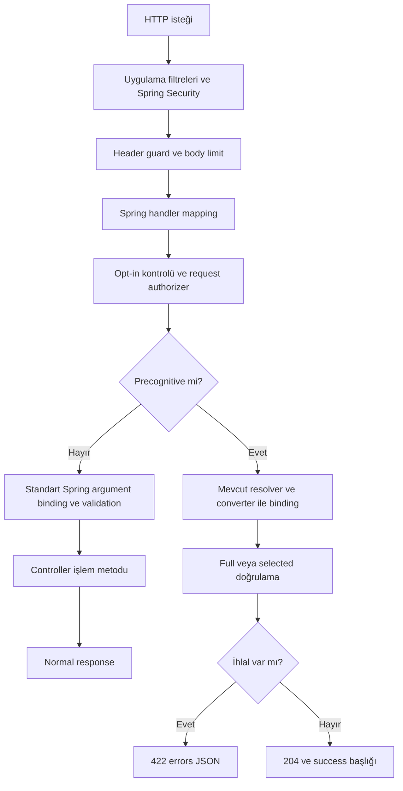

# Spring Precognition — Ürün ve Teknik Spesifikasyon

| Alan | Değer |
| --- | --- |
| Belge sürümü | 0.3 |
| Tarih | 21 Ekim 2026 |
| Durum | Modüler implementasyon mevcut; artifact yayını ve güncel dış doğrulama kabulü ayrı izlenir |
| Çalışma adı | Spring Precognition |
| İlk teslimat | Spring MVC üzerinde çalışan Spring Boot starter, örnek uygulama ve sözleşme testleri |
| İlk teknik hedef | Java 17+, Spring Boot 3.5.x, Spring Framework 6.2.x, Jakarta Validation, Jackson 2 |
| Belge dili | Türkçe; API, paket, hata kodları ve konfigürasyon anahtarları İngilizce |

Bu belge ürün davranışını, ilk sürümün sınırlarını, önerilen uygulama mimarisini ve yayın kabul koşullarını tanımlar. `MUST` zorunluluğu, `SHOULD` gerekçeli istisnası olabilecek güçlü öneriyi, `MAY` isteğe bağlı davranışı belirtir. Kaynaklarla doğrulanan framework özellikleri ile bu paket için alınan tasarım kararları ayrı değerlendirilmelidir. Aşağıdaki Java API'leri önerilen sözleşmelerdir; mevcut bir kütüphanenin API'si değildir.

Belge kapsamındaki sürüm numaraları birer uyumluluk hedefidir. Uygulamaya başlanırken kesin bağımlılık sürümleri sabitlenmeli ve CI'da doğrulanmalıdır. Spring Boot 3.5 seçimi ilk adaptörü sınırlamak içindir; bu serinin en güncel ana sürüm olduğu iddia edilmez. Spring Boot 4 / Spring Framework 7 desteği ayrı adaptör ve test matrisi gerektirir.

Implementasyon revizyonu: public API, ortak MVC implementasyonu, Boot 3/4 auto-configuration ve iki starter gerçek Maven modüllerine ayrıldı. Başlangıç verifier'ı, FULL/SELECTIVE, ordinary DTO/scalar tipler, JSON wire-name eşlemesi, authorizer/context SPI, disabled guard, kaynak limitleri ve ObservationRegistry entegrasyonu uygulandı. Boş seçim no-op 204'tür. Erken 401/403 status/body/challenge korunarak işaretlenir. Doğrudan `@Valid` nested graph desteği ilk kapsamı genişletir; collection/index/wildcard ayrı kapsamdır. Önceki tek modüllü 167 test sonucu tarihçedir; yeni kaynak ve artifact kanıtları [VERIFICATION.md](VERIFICATION.md) içinde izlenir.

## İçerik

1. Problem, amaç ve ürün garantileri
2. Terimler ve kullanım senaryoları
3. Sürüm kapsamı ve destek matrisi
4. Geliştirici deneyimi ve public API
5. HTTP protokolü
6. Doğrulama semantiği
7. JSON bağlama ve alan adlandırma
8. Spring MVC mimarisi
9. Güvenlik ve yetkilendirme
10. Hata işleme ve yerelleştirme
11. Konfigürasyon ve otomatik yapılandırma
12. Modüller ve bağımlılıklar
13. Frontend entegrasyonu ve uyumluluk
14. Sonraki sürümlerde iç içe alanlar ve ilişkili kurallar
15. Performans, kaynak sınırları ve gözlemlenebilirlik
16. Test planı ve kabul kriterleri
17. Uygulama aşamaları ve yayın kapıları
18. Kararlar, riskler ve açık konular
19. Dokümantasyon ve tamamlanma tanımı
20. Referanslar

## 1. Problem, amaç ve ürün garantileri

### 1.1 Problem

Bir formun kuralları sıklıkla backend'de Jakarta Validation anotasyonlarıyla, frontend'de ise başka bir doğrulama sistemiyle tanımlanır. Aynı kural iki yerde yaşar; mesajlar, koşullar ve veritabanına bağlı kontroller zamanla farklılaşabilir. Alternatif olarak her form için ayrı bir doğrulama endpoint'i yazılması, asıl endpoint ile birlikte bakım gerektirir.

Paket, mevcut işlem endpoint'ini bir doğrulama isteği için kullanarak bu tekrarları azaltır. Kullanıcı form alanından çıktığında veya kısa bir yazma arası verdiğinde frontend aynı URL ve HTTP metodu üzerinden doğrulama ister. Backend, desteklenen istek bağlama ve doğrulama adımlarını yürütür; işlem metoduna geçmeden yanıt verir.

Laravel Precognition bu yaklaşımın referansıdır: route middleware'leri ve bağımlılık çözümleme/doğrulama aşamaları çalışırken route'un controller metodu çağrılmaz. [Laravel Precognition açıklaması](https://laravel.com/docs/13.x/precognition)

### 1.2 Amaçlar

- **G-01:** Form kurallarının tek kaynağı olarak backend doğrulama modelini kullanmak.
- **G-02:** Her işlem için ayrı bir `/validate` endpoint'i gerektirmemek.
- **G-03:** Normal istek ile canlı doğrulama isteğinde aynı DTO tipini, JSON eşlemesini ve desteklenen constraint tanımlarını kullanmak.
- **G-04:** Yalnızca istenen alanların doğrulamasını yapabilmek; ilgisiz validator'ları çalıştırmamak.
- **G-05:** Doğrulama isteğinde controller işlem metodunun çağrılmasını engellemek.
- **G-06:** Spring Security'nin istek seviyesindeki kimlik doğrulama ve yetkilendirmesini korumak.
- **G-07:** Kurulumu bir bağımlılık, endpoint anotasyonu ve isteğe bağlı ayarlar seviyesinde tutmak.
- **G-08:** Laravel frontend istemcileriyle test edilebilir bir HTTP uyumluluk profili sunmak.

### 1.3 Garantinin sınırı

Ürünün garantisi, desteklenen endpoint için **controller işlem metodunu çağırmadan doğrulama yapmaktır**. Bu bir uygulamanın tamamını yan etkisiz çalıştıran sandbox değildir.

Servlet filtreleri, güvenlik bileşenleri, interceptor'lar, JSON constructor/deserializer'ları, getter'lar, request advice'ları ve custom validator'lar yine çalışabilir. Bunların veritabanına yazması veya dış servise çağrı yapması teknik olarak mümkündür. Paket kullanıcı kodunu genel olarak analiz edip bu davranışları engelleyemez.

Bu nedenle:

- Paket MUST controller işlem metoduna giden yolu kapatmalıdır.
- Paket MUST işlem metodunu çalıştırıp transaction rollback yapmayı bir çözüm olarak kullanmamalıdır.
- Validator, yetkilendirme politikası ve bağlama bileşenleri SHOULD iş verisi değiştirmemelidir.
- Audit, metrik, oturum erişimi gibi altyapı yan etkileri olabilir; dokümantasyon bunları gizlememelidir.
- Başarılı doğrulama MUST daha sonraki submit'in başarılı olacağına dair garanti veya rezervasyon sayılmamalıdır.
- Gerçek submit MUST yeniden tam doğrulama yapmalıdır. Veritabanı unique constraint'leri ve transaction kuralları geçerliliğini korur.

### 1.4 Amaç dışı işler

- Controller/servis gövdesindeki bütün iş kurallarını otomatik keşfetmek.
- Frontend'e Java constraint kodu veya bütün doğrulama şeması göndermek.
- İşlem oluşturup geri almak; ödeme, e-posta, event veya dosya yazımını simüle etmek.
- Laravel'in PHP doğrulama kurallarını Java'ya birebir taşımak.
- Kimlik doğrulama sistemi, rate limiter veya veritabanı migration aracı sağlamak.
- İlk sürümde WebFlux, GraphQL, multipart veya native image desteği ilan etmek.

## 2. Terimler ve kullanım senaryoları

| Terim | Anlam |
| --- | --- |
| Normal istek / submit | Precognition başlığı taşımayan veya `Precognition: false` taşıyan işlem isteği |
| Precognitive istek | Tek bir `Precognition: true` başlığıyla işaretlenen doğrulama isteği |
| Opt-in endpoint | `@Precognitive` ile açıkça etkinleştirilmiş desteklenen handler |
| Full doğrulama | Alan seçimi olmadan endpoint'in desteklenen giriş modelinin tamamının doğrulanması |
| Selected doğrulama | `Precognition-Validate-Only` içindeki alanların kurallarının çalıştırılması |
| Wire alan adı | JSON'da ve HTTP hata yanıtında görünen alan adı; örneğin `first_name` |
| Java property adı | Validator'ın kullandığı Java model adı; örneğin `firstName` |
| Endpoint descriptor | Handler, DTO, alan eşlemesi, doğrulama modu ve güvenlik uygunluğunun immutable metadatası |
| Desteklenmeyen yapı | Belirlenen sürümde güvenilir şekilde işlenemeyen anotasyon, imza veya DTO özelliği |
| Fail closed | Desteklenmeyen isteği reddetmek; normal işleme geri düşerek controller'ı çalıştırmamak |

### 2.1 Canlı alan doğrulama

1. Kullanıcı e-posta alanını düzenler.
2. Frontend, debounce veya blur sonrası güncel form snapshot'ını gönderir.
3. `Precognition-Validate-Only: email` ile yalnızca e-posta kuralları istenir.
4. Backend, DTO'yu bağlar ve e-posta constraint'lerini çalıştırır.
5. Geçerliyse `204`; geçersizse alan mesajlarıyla `422` döner.
6. Kullanıcı oluşturulmaz.

### 2.2 Çok adımlı form

Frontend mevcut adımın alanlarını virgülle ayrılmış olarak seçer. Diğer alanlardaki constraint ihlalleri bu yanıtı başarısız yapmaz. Bununla birlikte payload'ın tamamı geçerli JSON olmalı ve DTO'ya bağlanabilmelidir. Alan seçimi JSON parsing veya type conversion işlemini kısmi hale getirmez.

### 2.3 Tam form ön kontrolü

Frontend `Precognition: true` gönderir, alan seçimi başlığını göndermez. Backend desteklenen bütün giriş modelini doğrular; controller metodu yine çalışmaz.

### 2.4 Veritabanına bağlı kontrol

Örneğin `@AvailableEmail` gibi uygulamaya ait bir property constraint'i, yetkilendirilmiş tenant kapsamında okuma yapabilir. Aynı anotasyon normal submit'te de kullanılır. Paket bu constraint'i üretmez, repository seçmez ve unique kaydını rezerve etmez. Son submit'te oluşabilecek yarış koşullarını uygulama yönetir.

### 2.5 Mevcut uygulamaya ekleme

Yalnızca seçilen handler'lar etkinleştirilir. Diğer endpoint'lerin normal istekleri mevcut akışta kalır. Yanlışlıkla etkinleştirilmemiş bir endpoint'e gönderilen precognitive istek, controller'a geçmeden reddedilir.

## 3. Sürüm kapsamı ve destek matrisi

### 3.1 İlk sürüm: 0.1

0.1, açık kapsamlı bir Spring MVC starter implementasyonu ve gerçek frontend form entegrasyonu sağlar; bütün Laravel özelliklerini kapsayan bir 1.0 eşdeğerlik taahhüdü değildir.

| Özellik | 0.1 davranışı |
| --- | --- |
| Java | 17 bytecode tabanı; CI'da Java 17 ve 21 |
| Spring | Boot 3.5.x / Framework 6.2.x adaptörü |
| Web stack | Servlet tabanlı Spring MVC |
| Metotlar | `POST`, `PUT`, `PATCH` |
| Giriş gövdesi | Tek, zorunlu `@RequestBody` DTO; kökte JSON object |
| JSON | `application/json`; kayıtlı JSON converter ile desteklenen `application/*+json` |
| DTO | Java record veya sıradan DTO; düz, scalar property'ler |
| Scalar tipler | String, boxed sayılar/boolean, BigDecimal, BigInteger, enum, standart tarih/saat tipleri ve UUID; converter desteğine bağlı |
| Property constraint'leri | Standart Jakarta constraint'leri ve uygulamaya ait property constraint'leri |
| `@Valid` / `@Validated` | Gövde parametresinde zorunlu; 0.1'de yalnızca Default grubu |
| Selected modu | Düz property'lerde `validateProperty` temelli doğrulama |
| Full modu | Aynı düz DTO üzerinde `validate` |
| Class-level constraint | Yalnızca `FULL` endpoint modunda; selected endpoint'te başlangıç hatası |
| JSON alan isimleri | Tekil `@JsonProperty` ve standart naming strategy eşlemesi |
| Güvenlik | Servlet security filter chain ve ortak request authorizer |
| Method security | Opt-in controller üzerinde desteklenmez; tespit edilen yapı başlangıçta reddedilir |
| Normal hata biçimi | Opt-in endpoint'in Bean Validation hataları varsayılan olarak Laravel biçimi / 422; korunabilir ayar |
| Frontend | Bağımsız HTTP sözleşmesi; Laravel React/Vue uyumluluğu test kapısına bağlı |

Spring Boot 3.5 için Java 17 tabanı ve Spring 6.2 bağımlılığı resmi sistem gereksinimleriyle uyumludur. Kesin patch sürümleri build dosyasında ayrıca sabitlenecektir. [Boot 3.5 gereksinimleri](https://docs.spring.io/spring-boot/3.5/system-requirements.html)

### 3.2 0.1'de desteklenmeyen yapılar

Opt-in endpoint'te aşağıdaki yapılar MUST sessizce kısmi başarıya dönüştürülmemelidir:

- Collection, array, map, Optional ve container element constraint'leri. Doğrudan `@Valid` nested DTO/record grafiği 8 seviye ve alan limitiyle desteklenir.
- Primitive gövde property'leri: eksik değerlerin `0` / `false` haline gelmesini önlemek için boxed tip istenir.
- `@JsonAlias`, `@JsonUnwrapped`, polymorphic type metadata, dinamik property isimleri ve belirsiz property eşlemeleri.
- `@RequestPart`, `MultipartFile`, `@ModelAttribute` veya birden çok gövde kaynağı.
- `BindingResult` / `Errors` parametresi.
- Doğrudan controller parametrelerinde constraint ve controller metodu için cross-parameter constraint.
- Controller seviyesinde `@Validated` ve desteklenmeyen method-validation proxy'leri.
- Grup sıraları, Default group yeniden tanımı, dinamik group sequence provider, group conversion ve özel validation grupları.
- Opt-in handler'ı etkileyen `@SessionAttributes` ve `@ModelAttribute` model üretme metotları.
- Opt-in handler'a uygulanan `@InitBinder` metotları veya Bean Validation dışında ek MVC validator'ları.
- Custom handler argument resolver gerektiren controller parametreleri.
- Async/reactive/streaming handler imzaları, Kotlin suspend, fonksiyonel routing.
- Servlet `FORWARD` veya `ASYNC` dispatch ile başlatılan precognitive işlem.

Statik olarak belirlenebilen uyumsuzluklar uygulama başlangıcını MUST başarısız kılmalıdır. Runtime'da ortaya çıkan konfigürasyon sapmasında `500 PRECOGNITION_CONFIGURATION_ERROR` dönmeli ve controller MUST çalışmamalıdır.

Controller dönüş tipi ordinary JSON body veya `ResponseEntity` olabilir. `void` ve `@ResponseStatus` da kabul edilir. Precognitive başarıda bunların normal durum kodları kullanılmaz; her zaman `204` üretilir.

### 3.3 Controller parametreleri

Gövdeye ek olarak yalnızca kayıtlı built-in resolver'larla çözülen `@PathVariable`, `@RequestParam`, `@RequestHeader` ve `java.security.Principal` desteklenir. Scalar girişler için gerekli değer ve type conversion kontrolleri geçerlidir; bunların üzerine Jakarta constraint konulması 0.1'de desteklenmez.

`HttpServletRequest`, `HttpServletResponse`, `Model`, `SessionStatus`, `@SessionAttribute`, `@RequestAttribute`, `@CookieValue`, `HttpEntity`, `RequestEntity`, authentication principal özelleştirmeleri ve liste/map parametreleri başlangıçta kapsam dışında tutulur. Yeni parametre türü ancak açık test matrisiyle eklenir.

### 3.4 Sonraki teslimatlar

| Teslimat | Hedef |
| --- | --- |
| 0.2 | Nested alanlar, array/collection yolları, alanlar arası kurallar için açık SPI, özel gruplar için kontrollü destek |
| 0.3 | Spring Security before-method authorization adaptörü, daha geniş MVC özelleştirme desteği |
| 1.0 | Kararlı public API, sabit uyumluluk profili, sürüm matrisi, yayın ve bakım politikası |
| Ayrı adaptör | Boot 4 / Spring 7 / ilgili JSON ve Validation sürümleri |
| Daha sonra | Multipart, WebFlux, AOT/native; ayrı tasarım ve kabul testleri gerekir |

Bu satırlar yayın tarihi taahhüdü değildir. 1.0 için bütün sonraki özelliklerin tamamlanması şart değildir; yayınlanan kapsamın net ve test edilmiş olması şarttır.

## 4. Geliştirici deneyimi ve public API

### 4.1 Kurulum

Artifact adları Boot sürümüne göre `precognition-spring-boot3-starter` ve `precognition-spring-boot4-starter` olarak ayrılır. Group ID ve Java kök paketi yayın öncesinde sahipliği doğrulanarak kesinleştirilecektir. Örneklerdeki `dev.precognition` geçici bir namespace'tir.

```xml
<dependency>
    <groupId>dev.precognition</groupId>
    <artifactId>precognition-spring-boot3-starter</artifactId>
    <version>${precognition.version}</version>
</dependency>
```

```kotlin
implementation("dev.precognition:precognition-spring-boot3-starter:$precognitionVersion")
```

Starter MVC ve Validation entegrasyonu için gerekli bağımlılıkları getirir. Jackson/provider sürümlerini Spring Boot BOM yönetmelidir. Paket MUST uygulamanın Spring veya Hibernate Validator sürümünü gizlice yükseltmemelidir.

### 4.2 Endpoint anotasyonu

```java
@Target(ElementType.METHOD)
@Retention(RetentionPolicy.RUNTIME)
@Documented
public @interface Precognitive {
    PrecognitionMode mode() default PrecognitionMode.SELECTIVE;
}

public enum PrecognitionMode {
    SELECTIVE,
    FULL
}
```

- `SELECTIVE`: Alan seçimi başlığı varsa seçilen property'ler; başlık yoksa full doğrulama.
- `FULL`: Yalnızca alan seçimi olmayan full doğrulama; seçim başlığı `400 SELECTION_NOT_SUPPORTED` üretir.
- Anotasyon 0.1'de yalnızca somut controller metoduna konur. Interface, class ve composed endpoint anotasyonu desteği ilan edilmez.
- Aynı Java metodunun bütün URL mapping'leri aynı descriptor'ı kullanır.
- Anotasyon MUST otomatik olarak herkese açık erişim oluşturmamalıdır.

### 4.3 Temel örnek

```java
public record CreateUserRequest(
    @NotBlank
    @Size(max = 100)
    String name,

    @NotBlank
    @Email
    String email,

    @NotNull
    @Min(18)
    Integer age
) {}

@RestController
@RequestMapping("/users")
public class UserController {
    private final UserService users;

    public UserController(UserService users) {
        this.users = users;
    }

    @Precognitive
    @PostMapping
    @ResponseStatus(HttpStatus.CREATED)
    public UserResponse create(@Valid @RequestBody CreateUserRequest request) {
        return users.create(request);
    }
}
```

Normal geçerli istek `users.create` çağrısını yapar ve `201` döner. Precognitive geçerli istek `users.create` çağrısını yapmaz ve `204` döner. Gerçek controller metoduna giriş sayacıyla bu fark test edilir.

### 4.4 Ortak request authorizer

```java
public interface PrecognitionAuthorizer {
    AuthorizationDecision authorize(EndpointRequest request);
}

public record AuthorizationDecision(boolean granted) {}
```

`EndpointRequest`, handler kimliği, normalize edilmiş path variable'lar, principal, HTTP metodu, route template ve salt okunur request metadata sağlar. DTO içermez; bu politika JSON bağlamadan önce çalışır. Ham response yazma veya controller çağırma yetkisi vermez.

Kayıtlı authorizer'lar tanımlı sırayla çalışır. Birinin reddi işlemi durdurur. Hiç authorizer yoksa ek paket politikası uygulanmaz; mevcut security filter chain yine belirleyicidir. Aynı authorizer zinciri opt-in endpoint'in normal ve precognitive isteklerinde MUST çalışmalıdır.

Gövdeye bağlı yetkilendirme bu API ile çözülmez; ayrı sürüm gerektirir. Servis katmanındaki mevcut güvenlik kontrolleri normal submit'te kalır; precognitive isteğin servis çağrısını yapacağı varsayılmaz.

### 4.5 İstek bağlamı

```java
public interface PrecognitionContextAccessor {
    Optional<PrecognitionContext> current();
}

public record PrecognitionContext(
    boolean precognitive,
    ValidationScope scope,
    Set<String> selectedWireFields,
    Locale locale
) {}

public enum ValidationScope {
    FULL,
    SELECTED
}
```

Bağlam servlet request attribute'unda tutulmalıdır. Kullanıcıya global mutable state veya static `ThreadLocal` yazma zorunluluğu getirilmez. Request dışındaki erişim `Optional.empty()` döndürür. Normal opt-in istekte bağlam `precognitive=false`, `scope=FULL` olarak kullanılabilir. Set immutable ve request'e özeldir; full modda boş set, hiçbir alan doğrulanmadığı anlamına gelmez.

Accessor, custom validator'ın precognitive isteği tanıyabilmesini sağlar. Kuralları precognitive ve normal isteklerde farklılaştırmak uygulama kararıdır; böyle bir farklılaşma eşdeğerlik garantisini daraltır ve belgelenmelidir.

## 5. HTTP protokolü

### 5.1 Protokol profili

Profil adı `laravel-http-v1` olacaktır. Bu isim bu paketin sözleşmesini sürümlemek içindir; Laravel'in resmi protokol sürümü olduğu iddia edilmez. İlk sürüm bu tek profili uygular.

Referans Laravel kaynakları başlık üzerinden precognitive isteği tanımlar, alan listesine göre kural seçer ve başarıda `204` ile `Precognition-Success: true` döndürür. Bu paket aynı temel alışverişi hedefler; katı parsing, açık hata kodları ve sınırlı alan yolu desteği aşağıda ayrıca tanımlanmıştır. [İstek başlıkları](https://github.com/laravel/framework/blob/13.x/src/Illuminate/Http/Concerns/CanBePrecognitive.php), [başarı yanıtı](https://github.com/laravel/framework/blob/13.x/src/Illuminate/Foundation/Routing/PrecognitionControllerDispatcher.php)

### 5.2 İstek başlıkları

| Başlık | Davranış |
| --- | --- |
| `Precognition` | Tek değer; OWS temizlendikten sonra küçük harfle tam `true` veya `false` |
| `Precognition-Validate-Only` | Yalnızca precognitive istekte; virgülle ayrılmış wire alan adları |
| `Content-Type` | Desteklenen JSON media type; gövde zorunlu |
| `Accept` | `application/json` veya JSON kabul eden wildcard; kabul etmiyorsa 406 |
| `Accept-Language` | Uygulamanın locale çözümlemesine katılır |
| Auth / CSRF başlıkları | Normal endpoint ile aynı gereksinimler |

HTTP header isimleri büyük/küçük harf duyarsızdır. `Precognition` değeri için `TRUE`, `1`, boş değer veya virgülle birleştirilmiş değer `400 INVALID_PRECOGNITION_HEADER` üretir. `Precognition` başlığının aynı veya farklı değerlerle tekrarı da `400` üretir.

`Precognition-Validate-Only` başlığı tekrarlanamaz. `Precognition` yokken veya `false` iken alan seçimi başlığı bulunması `400 ORPHAN_SELECTION_HEADER` üretir. Geçerli `false` ve seçim başlığı bulunmaması normal istek demektir.

Bu katılık, Laravel'in yalnızca tam `true` eşleşmesini kontrol eden davranışının bilinçli olarak daraltılmasıdır. Amaç hatalı işaretlenmiş bir isteğin yanlışlıkla normal işleme geçmesini engellemektir.

### 5.3 Alan listesi

Örnek:

```http
Precognition-Validate-Only: name,email,age
```

- Her token çevresindeki ASCII space/tab temizlenir.
- Tekrarlanan alanlar ilk görüldükleri sıra korunarak tekilleştirilir.
- Başlığın boş veya yalnız ASCII space/tab olması boş seçimdir: desteklenen JSON gövdesi bağlanır, constraint ve controller çalıştırılmadan 204 döner. Virgülle ayrılan listede boş token veya başta/sonda virgül `400 INVALID_FIELD_SELECTION` üretir.
- Token grameri `[A-Za-z_][A-Za-z0-9_-]*(\.[A-Za-z_][A-Za-z0-9_-]*)*` olacaktır; her bölüm descriptor'da kayıtlı olmalıdır.
- Seçim MUST descriptor'daki bind edilebilir wire property'lerinden yapılmalıdır.
- Bilinmeyen, read-only veya ignore edilmiş alan `400 UNKNOWN_VALIDATION_FIELD` üretir.
- Header içinde URL decoding, JSON Pointer decoding, SpEL, serbest property traversal veya bean expression değerlendirmesi MUST yapılmamalıdır; yalnız immutable descriptor yolları kullanılabilir.
- Noktalı yollar yalnız kayıtlı nested DTO grafiğinde desteklenir. Köşeli parantez ve wildcard `400 INVALID_FIELD_SELECTION` üretir.
- Liste sırası constraint yürütme sırası garantisi oluşturmaz.
- Başlık yoksa full doğrulama; mevcut boş başlık `scope=SELECTED, fields=[]` olarak tutulur ve hiçbir zaman full doğrulamaya dönüşmez.

### 5.4 Başarılı selected isteği

```http
POST /users HTTP/1.1
Precognition: true
Precognition-Validate-Only: email
Content-Type: application/json
Accept: application/json

{"name":"","email":"ada@example.test","age":null}
```

```http
HTTP/1.1 204 No Content
Precognition: true
Precognition-Success: true
Cache-Control: no-store
Vary: Precognition, Precognition-Validate-Only
```

`name` ve `age` constraint'leri çalıştırılmaz. `204` yanıtında body ve JSON content type MUST bulunmamalıdır. Endpoint'in `@ResponseStatus(CREATED)` anotasyonu precognitive başarıya uygulanmaz.

### 5.5 Başarısız selected isteği

```http
POST /users HTTP/1.1
Precognition: true
Precognition-Validate-Only: email
Content-Type: application/json
Accept: application/json

{"name":"","email":"invalid","age":null}
```

```http
HTTP/1.1 422 Unprocessable Content
Content-Type: application/json
Precognition: true
Cache-Control: no-store
Vary: Precognition, Precognition-Validate-Only

{
  "message": "The given data was invalid.",
  "errors": {
    "email": ["must be a well-formed email address"]
  }
}
```

Mesajlar locale ve uygulama mesaj dosyalarına göre değişebilir. `errors` değerleri MUST string dizisi olmalıdır. `Precognition-Success` hata yanıtlarında MUST bulunmamalıdır.

### 5.6 Durum kodları

| Kod | Durum | Controller çalışır mı? |
| --- | --- | --- |
| 204 | Desteklenen doğrulama başarılı | Hayır |
| 422 | Desteklenen constraint ihlali | Hayır |
| 400 | Hatalı başlık/seçim, JSON parse, gövde veya scalar bağlama hatası | Hayır |
| 401 / 403 | Uygulamanın authentication / authorization / CSRF reddi | Hayır |
| 404 / 405 | Route bulunamadı / HTTP metodu eşleşmedi | Hayır |
| 406 | İstemci JSON yanıtını kabul etmiyor | Hayır |
| 412 | Route opt-in değil veya paket özelliği devre dışı | Hayır |
| 413 | Precognitive body sınırı aşıldı | Hayır |
| 415 | Desteklenmeyen content type / content encoding | Hayır |
| 431 | Paket veya container header sınırı aşıldı | Hayır |
| 429 | Uygulamanın rate limit reddi | Hayır |
| 500 | Validator hatası veya beklenmeyen iç hata | Hayır |
| 503 | Uygulamanın açıkça unavailable olarak eşlediği dış bağımlılık arızası | Hayır |

Desteklenmeyen rota için `412` bu paketin tasarım kararıdır; Laravel'den birebir kopyalanmış bir durum kodu taahhüdü değildir. Standart security/filter/container yanıtlarının body biçimi uygulamaya aittir.

### 5.7 Opt-in olmayan endpoint ve devre dışı mod

- Aktif paket, `Precognition: true` taşıyan bir isteği opt-in olmayan handler'a MUST geçirmemelidir.
- İsteği normal submit'e çeviren fallback MUST bulunmamalıdır.
- Mapping bulunamadığında mevcut 404/405 davranışı korunabilir; controller çağrısı oluşmaz.
- `precognition.enabled=false` olsa da minimal header guard MUST aktif kalmalıdır. Geçerli precognitive isteğe `412 PRECOGNITION_DISABLED` döner.
- Paket uygulamadan tamamen çıkarılmışsa bu koruma garantisi yoktur. Frontend ve backend dağıtımları buna göre koordine edilmelidir.

### 5.8 Yanıt başlıkları ve cache

- Kabul edilmiş precognitive endpoint isteğinde paket tarafından üretilen sonuçlar `Precognition: true` taşır.
- Başarıda ek olarak `Precognition-Success: true` taşınır.
- Opt-in olmayan veya kapalı özellik için üretilen 412'de `Precognition: true` bulunmaz.
- Opt-in endpoint'in normal yanıtları da mevcut `Vary` değerleri korunarak `Precognition` ve `Precognition-Validate-Only` ile genişletilir.
- Var olan `Vary: *` değiştirilmez; başlık isimleri case-insensitive tekilleştirilir.
- Paketin precognitive yanıtları `Cache-Control: no-store` taşır. Bunlar için ETag veya 304 üretimi yapılmaz.
- Tek ve geçerli sinyal taşıyan erken 401/403 yanıtları response wrapper ile işaretlenir; diğer erken filter/container yanıtlarının gövde ve başlıkları uygulamaya aittir.

## 6. Doğrulama semantiği

### 6.1 Full doğrulama

Full istek aşağıdaki koşullarda `jakarta.validation.Validator.validate(body)` eşdeğerini kullanır:

1. Handler uygun ve opt-in olmalıdır.
2. Request-level security ve ortak authorizer başarılı olmalıdır.
3. Bütün controller girişleri bağlanabilmelidir.
4. DTO desteklenen biçimde olmalıdır.
5. Sonuçtaki bütün desteklenen constraint ihlalleri yanıta eklenir.

Controller dönüş değeri constraint'leri çalıştırılmaz. Controller/servis gövdesindeki kontroller çalıştırılmaz. Full, endpoint'in bütün muhtemel iş sonuçlarının öngörüldüğü anlamına gelmez.

### 6.2 Selected doğrulama

0.1'de her seçili wire alanı bir Java property adına çevrilir. Aynı bağlı DTO üzerinde her property için `validateProperty(body, javaProperty)` çağrılır. Property constraint değerlendirmesini Jakarta provider yapar; paket constraint implementasyonlarını kendisi çağırmaz.

Bu API property doğrulamayı sağlar, cascade `@Valid` işlemez ve taşınabilir biçimde nested path kabul etmez. Bu nedenle düz model kapsamı bilinçlidir. [Jakarta Validation, doğrulama metotları](https://jakarta.ee/specifications/bean-validation/3.0/jakarta-bean-validation-spec-3.0.html#validationapi-validatorapi-validationmethods)

Zorunlu davranışlar:

- **VAL-01:** Seçili olmayan property'nin validator'ı çalışmamalıdır. Sonuç filtresi bu şartı karşılamaz.
- **VAL-02:** Seçili olmayan property'nin constraint ihlali selected yanıtını etkilememelidir.
- **VAL-03:** İstek body’sinin tamamı JSON parsing / deserialization aşamasından geçer.
- **VAL-04:** Seçili olmayan alandaki type conversion hatası 400 üretebilir; bu bir constraint ihlali değildir.
- **VAL-05:** Bilinen ama constraint taşımayan seçili alan, bağlama başarılıysa geçerli sayılır.
- **VAL-06:** Aynı property hem field hem getter üzerinde constraint taşıyorsa provider semantiği korunur.
- **VAL-07:** Constraint composition ve repeatable constraint davranışını provider belirler; paket flatten ederek yeniden uygulamaz.
- **VAL-08:** Validation exception veya uygulama validator'ındaki hata 422 olarak gizlenmez.

### 6.3 Eksik, null ve boş değer

| Giriş | 0.1 davranışı |
| --- | --- |
| Seçili alan JSON'da yok | Jackson'ın ürettiği DTO değeri doğrulanır; çoğunlukla null |
| Alan açıkça null | Null üzerinden constraint değerlendirilir |
| Boş string | String olarak bağlanır; `@NotBlank` gibi kurallar karar verir |
| DTO field initializer/default | Normal deserialization ile aynı değer kullanılır |
| Gövde yok veya JSON `null` | 400; Bean Validation çalıştırılmaz |
| DTO constructor reddi | 400 deserialization hatası; başarıya çevrilmez |

Paket eksik alanları veritabanından veya önceki form isteğinden doldurmaz. Oturumda DTO biriktirmez. `PATCH` desteği yalnızca HTTP metodunun desteklenmesi demektir; otomatik JSON Merge Patch veya mevcut entity birleştirmesi değildir.

### 6.4 Null hassasiyeti

`@Email` tek başına zorunlu alan tanımlamaz. Zorunlu e-posta için uygulama `@NotBlank @Email` kullanmalıdır. Paket Jakarta constraint semantiğini değiştiren örtük required kuralı eklemez.

### 6.5 Class-level kurallar

`mode=FULL` olan düz DTO'da class-level constraint çalışır. Constraint property node ekliyorsa ilgili wire alana, eklemiyorsa `_form` anahtarına yazılır. `_form` ürünün rezerve ettiği hata anahtarıdır ve DTO wire alanı olarak kullanılamaz.

`SELECTIVE` endpoint'te class-level constraint bulunması, bazı isteklerde eksik doğrulama üretmemek için başlangıç hatasıdır. Endpoint'i full moduna almak veya sonraki sürümdeki açık rule adapter modelini kullanmak gerekir.

### 6.6 Tek seferlik doğrulama

Precognitive istekte varsayılan `@Valid` değerlendirmesi ile paket değerlendirmesi aynı kuralları iki kez çalıştırmamalıdır. Binder aşamasındaki otomatik bean doğrulaması yalnızca bu request'in precognitive yolunda kontrol altına alınır; daha sonra paket seçilen kapsamı bir kez değerlendirir.

Normal submit MUST standart Spring doğrulama yolunu kullanmalıdır. Paket normal istekte `@Valid` değerlendirmesini devre dışı bırakmamalı veya ikinci kez tekrarlamamalıdır.

### 6.7 Eşdeğerlik koşulu

Desteklenen düz DTO, aynı payload, aynı locale, aynı validator konfigürasyonu ve değişmeyen dış veri için:

```text
full precognitive giriş doğrulaması
    ≈ normal submit'in controller öncesi giriş doğrulaması

selected precognitive alan doğrulaması
    ≈ aynı property constraint'lerinin değerlendirilmesi
```

`≈`, hata alanı ve mesaj kümesi bakımından eşdeğerliği ifade eder. Constraint yürütme sırası, DB durumunun gelecekte aynı kalması veya işlem sonucunun eşdeğerliği anlamına gelmez. Normal submit ve precognitive istek farklı framework validasyon yollarına düştüğünde, eşdeğerlik ancak ilgili matris testleri geçerse ilan edilir.

## 7. JSON bağlama ve alan adlandırma

### 7.1 Tek JSON konfigürasyonu

Precognitive istek MUST uygulamanın mevcut `HttpMessageConverter` ve JSON mapper konfigürasyonunu kullanmalıdır. Ayrı bir default `ObjectMapper` yaratılıp normal istekten farklı formatlar kabul edilmemelidir.

Enum, tarih, timezone, coercion ve unknown JSON property davranışları uygulamanın converter ayarlarından gelir. Paket bunları normal ve precognitive istek arasında değiştirmemelidir.

### 7.2 Alan sözlüğü

Descriptor oluşturulurken uygulamanın aktif JSON mapper'ı üzerinden deserialize edilebilir property'ler çıkarılır. Her alan için en az şu bilgiler tutulur:

```text
wireName
javaPropertyName
javaType
readableForValidation
deserializable
constraintMetadata
```

Örnek:

```java
public record RegisterRequest(
    @JsonProperty("first_name")
    @NotBlank
    String firstName
) {}
```

İstemci `first_name` seçer; validator `firstName` kullanır; hata yanıtı yine `first_name` döner. İstemci `firstName` gönderirse bunun wire dictionary'de ayrıca kayıtlı olup olmadığı belirleyicidir; Java adına otomatik fallback yapılmaz.

### 7.3 Belirsizlik ve rezerve alanlar

- İki Java property aynı wire alanına eşleniyorsa başlangıç hatası.
- Wire alanı 0.1 grameri dışında kalıyorsa başlangıç hatası.
- `_form` alanı varsa başlangıç hatası.
- Yalnızca serialize edilen, ignore edilmiş veya read-only alan seçilemez.
- Bind edilebilir ama validator üzerinden güvenilir property erişimi olmayan model başlangıçta reddedilir.
- Constraint taşıyan ama wire dictionary'de karşılığı olmayan hesaplanmış/read-only property, 0.1'de başlangıç hatasıdır. Böylece full doğrulamada eşlenemeyen gizli bir alan hatası oluşmaz.
- Record constraint'lerinin metadata ve property doğrulama davranışı ilk teknik spike'ta test edilmelidir; reflection varsayımıyla destek ilan edilmez.

### 7.4 Güvenilmeyen alan adları

Header girdisi MUST doğrudan `BeanWrapper`, reflection, `Class.forName`, expression engine veya serbest property getter zincirine geçirilmemelidir. Önce immutable sözlükte birebir eşleşme zorunludur.

`class`, `classLoader`, `metaClass` ve benzeri Java altyapı adları yalnızca gerçek ve izinli bir DTO property'si gibi görünse bile 0.1'de rezerve edilerek reddedilmelidir. JSON type metadata çözümlemesiyle sınıf yükleme imkânı yaratılmamalıdır.

### 7.5 Request body sınırı

Precognitive body için sınırlı okuma uygulanır. `Content-Length` tek başına güvenilir değildir; chunked isteklerde de okunan byte sayısı sınırlandırılmalıdır. Hem `getInputStream()` hem `getReader()` yolları kapsanmalıdır. Gövde tek kez parse edilmeli; paketin kendisi sınırsız bir body kopyası tutmamalıdır.

0.1'de `Content-Encoding` yalnızca yok veya `identity` olabilir. Sıkıştırılmış request body 415 ile reddedilir; sıkıştırılmış veri boyutuyla sınır aşma belirsizliği yaratılmaz.

## 8. Spring MVC mimarisi

### 8.1 Tasarım kararı

Önerilen ana entegrasyon, Spring Boot'un `WebMvcRegistrations` mekanizmasıyla sağlanan bir `RequestMappingHandlerAdapter` alt sınıfı ve onun oluşturduğu özel `ServletInvocableHandlerMethod` olacaktır.

Boot bu yolla sağlanan MVC bileşenini sonraki MVC yapılandırmasından geçirir. Aynı uygulamada birden fazla `WebMvcRegistrations` tanımının koordinasyon gerektirmesi önemli bir entegrasyon sınırıdır. [Boot WebMvcRegistrations API](https://docs.spring.io/spring-boot/3.5/api/java/org/springframework/boot/autoconfigure/web/servlet/WebMvcRegistrations.html)

Bu yaklaşım bir tasarım önerisidir. İlk teknik spike ve entegrasyon testleri geçmeden bütün Spring özelleştirmeleriyle çalıştığı kabul edilmez.

### 8.2 Bileşenler

| Bileşen | Sorumluluk |
| --- | --- |
| `PrecognitionHeaderGuardFilter` | Başlık parse etme, kapalı özellikte ret, precognitive body sınırı, request context kurulumu ve cleanup |
| `PrecognitionEndpointRegistry` | Opt-in handler ve model descriptor'larını hazırlama; uygunluk doğrulama |
| `PrecognitionHandlerInterceptor` | Handler belli olduğunda opt-in kontrolü; ortak request authorizer; normal/precognitive Vary başlıkları |
| `PrecognitionRequestMappingHandlerAdapter` | Precognition davranışını taşıyan invocable method oluşturma |
| `PrecognitionServletInvocableHandlerMethod` | Precognitive istekte controller çağrısını atlama; bağlanan girdilerden doğrulamayı ve yanıtı yürütme |
| `PrecognitionBinderFactory` | Sadece bu precognitive request'in body binder'ındaki otomatik validator yürütmesini kontrol etme |
| `PrecognitionValidationEngine` | Full/selected stratejisi; Jakarta Validator delegasyonu |
| `PrecognitionFieldNameResolver` | Wire ve Java property eşlemesi |
| `PrecognitionResponseWriter` | 204, 422 ve paket hata yanıtlarının yazımı |
| `PrecognitionExceptionResolver` | Desteklenen bağlama ve normal submit validation hatalarının dar kapsamlı dönüşümü |
| `PrecognitionStartupVerifier` | Uyumlu adapter'ın gerçekten kurulduğunu ve bütün descriptor'ların uygun olduğunu doğrulama |

Bu adlar iç tasarımı tarif eder; public extension API yapılması gerekmeyen sınıflar public API sayılmamalıdır.

### 8.3 Akış



Security, parsing ve binding retleri şekli sade tutmak için diyagramda ayrı çizilmemiştir. Her biri controller'a geçmeden terminal yanıt üretebilir.

### 8.4 Header guard

Filtre security proxy'sinden sonra, `DispatcherServlet` öncesinde çalışacak şekilde kaydedilir. Security altyapısı yoksa yine dispatcher öncesinde çalışır. Filter registration sırası framework adaptör testlerinde doğrulanmalıdır; sabit bir order değerinin bütün uygulamalarda aynı sonucu vereceği varsayılmaz.

Filtre:

1. Başlıkları yalnızca bir kez parse eder.
2. Geçersiz sinyalde paket hata yanıtı verir.
3. Özellik kapalıysa precognitive isteği hemen reddeder.
4. Özellik açıksa request attribute'una immutable sinyal koyar.
5. Precognitive body'yi limitli request wrapper ile sarar.
6. Başarılı veya başarısız çıkışta request'e ait geçici kaynakları temizler.

Normal isteklerde body wrapper takılmaz. Filtre normal istek body’sini okumaz, buffer'lamaz veya converter'dan önce tüketmez. Yalnızca paket protokolü başlıklarıyla ilgilenir.

`REQUEST` dışındaki dispatch'ler ayrıca ele alınır: precognitive `FORWARD` / `ASYNC` girişine izin verilmez. İç `ERROR` dispatch yalnızca hata render etmek için kullanılabilir; asıl action'a yeniden dispatch yapılamaz. Aynı request için doğrulama ve yanıt üretimi iki kere çalıştırılmaz.

Desteklenmeyen dispatch `400 PRECOGNITION_UNSUPPORTED_DISPATCH` üretir. Standart uygulama error handler'ının hata render etmek için çağrılması, asıl controller işlem metodunun çağrılmasıyla aynı kabul edilmez; güvence asıl action'a ilişkindir.

### 8.5 Registry ve başlangıç doğrulaması

Registry, `RequestMappingHandlerMapping` tamamlandıktan sonra handler'ları tarar. Yalnızca `@Precognitive` olan handler'lar için descriptor üretir; bütün repository'yi veya classpath'i gelişigüzel taramaz.

Descriptor en az aşağıdakileri içermelidir:

```text
handler identity ve bridged method
route templates ve HTTP methods
body parameter index ve resolved body type
endpoint mode
wire ↔ Java property dictionary
validation metadata
supported resolver identities
authorizer chain reference
security compatibility result
```

Metadata immutable ve uygulama context'ine ait olmalıdır. Global static cache kullanılmaz. Runtime mapping kaydı veya mapper konfigürasyonu değişimi 0.1'de desteklenmez; uygulama context'i yeniden başlatılır. Test context'leri ve devtools restart'ları önceki descriptor'ları paylaşmaz.

Doğrulama yalnızca anotasyon reflection'ına dayanmamalıdır. Mümkün olduğunda Jakarta provider metadata'sı, Spring merged annotation desteği, proxy target class ve gerçek mapper introspection'ı kullanılmalıdır. Provider XML/programmatic mapping kullanıyorsa aynı metadata görülmeli; belirsizlikte destek iddiası yerine yapılandırma hatası verilmelidir.

### 8.6 Adapter ve invocable method

Spring 6.2 kaynak kodunda `RequestMappingHandlerAdapter`, argument resolver'ları ve binder factory'yi invocable method'a aktarır. `InvocableHandlerMethod` argümanları çözüp metot çağrısına geçer. Öneri, bu sınırda özel bir yürütme yolu oluşturmaktır. [Adapter kaynağı](https://github.com/spring-projects/spring-framework/blob/6.2.x/spring-webmvc/src/main/java/org/springframework/web/servlet/mvc/method/annotation/RequestMappingHandlerAdapter.java), [invocation kaynağı](https://github.com/spring-projects/spring-framework/blob/6.2.x/spring-web/src/main/java/org/springframework/web/method/support/InvocableHandlerMethod.java)

Kavramsal algoritma:

```text
invokeAndHandle(request, container):
    if request precognitive değilse:
        super.invokeAndHandle(request, container)
        return

    descriptor = registry.requireSupported(handler)
    scope = parseAndResolveSelection(request, descriptor)
    args = getMethodArgumentValues(request, container)
    body = args[descriptor.bodyParameterIndex]
    violations = engine.validate(body, scope, descriptor)
    responseWriter.write(violations)
    container.setRequestHandled(true)
    return
```

Zorunlu teknik koşullar:

- Precognitive branch MUST `super.invokeAndHandle`, `invokeForRequest`, `doInvoke` veya controller proxy'sinin gerçek metodunu çağırmamalıdır.
- JSON response için Accept kontrolü ve desteklenen media type kontrolü, doğrudan response yazımı nedeniyle atlanmamalıdır; bunlar body doğrulamasından önce tamamlanmalıdır.
- `getMethodArgumentValues` kullanılırken normal Spring resolver/converter altyapısı korunmalıdır.
- Binding sırasında otomatik Bean Validation'ın full çalışması, request-local binder kontrolüyle önlenmelidir.
- Doğrulama sonrası handler'ın normal return value handler'ları çalıştırılmamalıdır.
- Başarılı precognitive yanıt `@ResponseStatus`, normal dönüş tipi veya response advice nedeniyle `201`/`200` haline gelmemelidir.
- Her terminal precognitive branch request'in işlendiğini işaretlemelidir.
- Request başarıyla karşılanmamışsa controller'a devam eden catch/finally yolu bulunmamalıdır.
- Framework sürümünde gerekli protected extension point yoksa reflection ile private alana erişerek destek verilmemelidir.

Bu pseudocode derlenebilir bir implementasyon değildir. Binder lifecycle ve response commit ayrıntıları ilk spike'ın zorunlu çıktılarıdır.

### 8.7 Binder kontrolü

Özel invocable method'a atanan `WebDataBinderFactory` bir decorator ile sarılır. Decorator hem üç argümanlı hem `ResolvableType` taşıyan dört argümanlı `createBinder` çağrısının semantiğini korumalıdır. [WebDataBinderFactory API](https://docs.spring.io/spring-framework/docs/6.2.x/javadoc-api/org/springframework/web/bind/support/WebDataBinderFactory.html)

Precognitive body binder oluşturulduğunda:

1. Standart factory üzerinden request'e özel binder oluşturulur.
2. Binding result ve conversion ayarları korunur.
3. Beklenen Bean Validation konfigürasyonu dışında ek validator varsa runtime konfigürasyon hatası verilir.
4. Yalnızca bu binder'ın otomatik validator listesi boşaltılır veya eşdeğer no-op stratejisi uygulanır.
5. Bağlama tamamlandıktan sonra paket, aynı uygulama Validator bean'iyle gerekli kapsamı doğrular.

`DataBinder.replaceValidators` gibi public API'ler kullanılabilir; global Validator bean'i veya ortak resolver listesi request sırasında değiştirilmez. [DataBinder API](https://docs.spring.io/spring-framework/docs/6.2.x/javadoc-api/org/springframework/validation/DataBinder.html)

Body limit exception'ı converter tarafından `HttpMessageNotReadableException` içine sarılırsa güvenilir paket exception cause'u 413 olarak korunmalıdır. Genel parsing hatasıyla karıştırılıp 400'e çevrilmemelidir. Arbitrary uygulama exception cause zincirlerinden status tahmini yapılmaz.

Normal istekte decorator factory'ye aynen delege eder ve validator listesini değiştirmez. Bir isteğin seçili alanları başka bir isteğin binder'ını etkilememelidir. Bu koşul paralel istek testiyle kanıtlanır.

### 8.8 MVC yaşam döngüsünün sınırları

Invocable method sınırından önce model initialization gerçekleşebilir. Bu nedenle opt-in controller'a uygulanabilen `@ModelAttribute` metotları ve session model davranışları 0.1'de reddedilir. Bunları kontrol etmeden yalnızca `doInvoke` aşamasını atlamak yeterli güvence değildir.

`RequestBodyAdvice` ve JSON converter özelleştirmeleri normal Spring akışının parçası olarak çalışabilir; uygulama bunların doğrulama isteklerine uygun olmasından sorumludur. Custom advice'ın yan etkisiz olduğu paket tarafından otomatik doğrulanamaz. Ürünün controller çağrısı garantisi bunların devre dışı bırakıldığı anlamına gelmez.

### 8.9 Birlikte çalışma ve çakışma

- Uygulamada başka `WebMvcRegistrations` bean'i varsa paket sessizce ikinci bir bean eklememelidir.
- Adapter'ın manuel birleştirilmesi gerekir; örnek bir entegrasyon tarifi sağlanmalıdır.
- Mevcut özel `RequestMappingHandlerAdapter` otomatik olarak reflection ile değiştirilmemelidir.
- `@EnableWebMvc` veya manuel MVC kurulumu Boot yolunu devre dışı bırakıyorsa verifier bunu tespit etmelidir.
- Opt-in handler var ama Precognition adapter/guard kurulu değilse başlangıç MUST başarısız olmalıdır.
- Hiç opt-in handler yoksa durum diagnostik olarak gösterilir; geçerli precognitive istekler guard tarafından yine reddedilir.
- Kütüphane global bean overriding ayarını açmamalıdır.

### 8.10 Değerlendirilen alternatifler

| Alternatif | Değerlendirme |
| --- | --- |
| Yalnızca `HandlerInterceptor.preHandle` | Handler bilinir, fakat bağlı controller argümanları hazır değildir; binding'i yeniden yazmadan tam çözüm sağlamaz |
| Controller üzerinde AOP `@Around` | Bazı imzalarda binding sonrası çalışabilir; full `@Valid` daha önce tamamlanmış olabilir, security/advisor sırası ve dönüş tipi sorunları vardır |
| Yalnızca `RequestBodyAdvice` | Body görülebilir, fakat bu callback tek başına bütün argümanlar ve controller invocation üzerinde terminal kontrol sağlamaz |
| Yeni `/validate` endpoint'i | Teknik olarak basittir; bu ürünün aynı endpoint hedefini karşılamaz |
| Controller'ı çağırıp rollback | DB dışı yan etkileri geri alamaz; ürün garantisine aykırıdır |
| Filter içinde ayrı ObjectMapper | Uygulamanın converter, generic type ve advice davranışından sapma riski taşır |
| HandlerAdapter kaynak kodunu kopyalamak | Bakım yükü ve sürüm sapması yüksek; public/protected genişletme noktaları tercih edilir |

Interceptor'ın handler adapter'dan önce çalıştığı ve yürütmeyi durdurabildiği Spring sözleşmesinde tanımlıdır. [HandlerInterceptor API](https://docs.spring.io/spring-framework/docs/6.1.13/javadoc-api/org/springframework/web/servlet/HandlerInterceptor.html)

## 9. Güvenlik ve yetkilendirme

### 9.1 Güvenlik modeli

Precognitive istekler gerçek backend istekleridir. Doğrulama sonuçları kullanıcı, tenant veya kaynak hakkında bilgi sızdırabilir. Paket aşağıdaki sınırları MUST korumalıdır:

- Normal endpoint'in URL ve HTTP metodu korunur.
- Spring Security filter chain atlanmaz.
- CSRF kontrolü otomatik kapatılmaz.
- Authentication yokluğu, oturum süresi dolması ve erişim reddi validation başarısı olarak yorumlanmaz.
- Başlık eklemek kullanıcının yetkisini artırmaz.
- Endpoint üzerindeki uygulama request authorizer'ı normal ve precognitive isteklerde aynı biçimde uygulanır.
- Header guard ve seçim parsing'i security sisteminin yerine geçmez.

### 9.2 Method security sınırı

Spring method security, metot invocation'ına bağlanan AOP altyapısını kullanır. Controller çağrısı yapılmadığında bu kontrollerin otomatik çalışacağı varsayılamaz. [Spring method security mimarisi](https://docs.spring.io/spring-security/reference/servlet/authorization/method-security.html)

0.1'de opt-in controller'ı etkileyen aşağıdaki yapılar tespit edilirse başlangıç reddedilir:

- `@PreAuthorize`, `@PostAuthorize`, `@PreFilter`, `@PostFilter`.
- `@Secured`, JSR-250 rol anotasyonları ve eşdeğer meta-annotation'lar.
- Class, superclass veya interface üzerinden miras alınan method security metadata'sı.
- Paket tarafından anlamlandırılamayan, handler'a uygulanabilir method security advisor'ı veya custom authorization interceptor'ı.

Standart metadata taraması için target/bridged method ve Spring annotation çözümleme kuralları kullanılmalıdır. Programmatic/custom advisor güvenilir şekilde çözülemiyorsa proxy'nin güvenli olduğu varsayılmamalıdır. Spring AOP dışındaki AspectJ weaving ile güvenlik 0.1'de desteklenmez.

Bu kısıt yalnızca opt-in controller'a ilişkindir. Servis metodundaki `@PreAuthorize` normal submit'te çalışmaya devam eder; precognitive istek servisi çağırmadığından bu kontrolün sonucu öngörülmez. Servis kontrolüyle korunan bir bilginin validator'da okunması gerekiyorsa validator'a erişmeden önce eşdeğer request-level politika kurulmalıdır.

0.1'de `ignore-method-security=true` gibi bir kaçış ayarı sağlanmayacaktır. Daha geniş destek before-method authorization'ı ayrı yürütme ve yan etkisiz kalma koşulunu açıkça test eden sonraki adaptörle eklenebilir.

### 9.3 Authorizer sırası

Opt-in endpoint için işlem sırası:

```text
authentication + URL authorization + CSRF
→ handler opt-in/uygunluk kontrolü
→ ortak request authorizer
→ selection descriptor kontrolü
→ JSON binding
→ constraint validation
→ precognitive response veya normal controller invocation
```

Basit header syntax ve payload limit kontrolü gerektiği noktada daha erken ret verebilir. Bu, yetkisiz kullanıcıya constraint veya veritabanı sonucu gösterilmesini meşru kılmaz.

Authorizer reddi 403 üretir. Authorizer hata fırlatırsa default 500'dür; exception'ı izin anlamına çeviren fail-open davranışı MUST bulunmamalıdır. Politika aynı request'te bir kez yürütülür.

### 9.4 Veritabanı ve tenant kapsamı

- Uygulamanın validator'ı tenant ve principal kapsamını açıkça uygulamalıdır.
- Paket varsayılan olarak `@Unique` / `@Exists` gibi her repository'ye erişebilen constraint sağlamaz.
- Custom validator içinde uygulamanın erişim kontrollü read servisi kullanılmalıdır.
- Validation yanıtı kullanıcı enumeration riskini uygulamanın politikası çerçevesinde yönetmelidir; mesaj metinleri uygulamaya aittir.
- Paket validation sonucunu global veya kullanıcılar arası cache'lememelidir.
- Normal submit sırasında DB constraint'leri ve transaction sınırları her zaman son otoritedir.

### 9.5 CORS

Paket bütün origin'leri açan global CORS konfigürasyonu MUST eklememelidir. Uygulama şu başlıklara izin vermelidir:

```text
Allowed request headers:
  Precognition
  Precognition-Validate-Only
  Content-Type
  Authorization / uygulamanın CSRF başlıkları

Exposed response headers:
  Precognition
  Precognition-Success
```

`OPTIONS` preflight, normal CORS altyapısında işlenir; precognitive doğrulama değildir. Credential kullanılan uygulamalarda mevcut origin politikası korunur. Cross-origin sözleşmesi gerçek tarayıcı testiyle doğrulanmalıdır.

### 9.6 Yan etki ve cancellation

- Paket controller çalıştırmaz; buna bağlı servis/event/transaction akışı başlatılmaz.
- Validator içindeki yazma veya dış çağrı otomatik rollback edilmez.
- İstemcinin isteği iptal etmesi sunucudaki senkron validator'ın anında durduğunu garanti etmez.
- Paket Java thread'lerini zorla durdurma veya global transaction açma yoluna gitmez.
- Ağ/DB timeout'ları uygulamanın client ve connection pool ayarlarına aittir.

## 10. Hata işleme ve yerelleştirme

### 10.1 Validation hata gövdesi

```java
public record PrecognitionValidationResponse(
    String message,
    Map<String, List<String>> errors
) {}
```

Bu, wire biçimini gösteren bir taslaktır; DTO'nun public API olarak yayımlanması şart değildir. `errors` boşken 422 üretilmez. Seçili alanlarda hata varsa yalnızca ilgili property mesajları döner. Full class-level global hata `_form` altında yer alır.

### 10.2 Protokol ve altyapı hataları

Paketin kendisinin ürettiği validation dışı hata gövdesi:

```json
{
  "message": "The requested validation field is not supported.",
  "code": "UNKNOWN_VALIDATION_FIELD"
}
```

- `code` kararlı makine anahtarıdır; locale ile değişmez.
- `message` kullanıcıya gösterilebilir genel açıklamadır.
- Ham header, DTO değeri, Java class adı, constraint implementasyonu veya stack trace yazılmaz.
- Uygulamanın security, proxy, container veya rate limiter yanıtı bu biçime zorla dönüştürülmez.
- Paket 400 hatasına `errors` alanı ekleyip istemciye bunu sıradan field validation gibi sunmamalıdır.

### 10.3 Hata kodları

| Kod | HTTP |
| --- | --- |
| `INVALID_PRECOGNITION_HEADER` | 400 |
| `ORPHAN_SELECTION_HEADER` | 400 |
| `INVALID_FIELD_SELECTION` | 400 |
| `UNKNOWN_VALIDATION_FIELD` | 400 |
| `UNSUPPORTED_FIELD_PATH` | 400 |
| `SELECTION_NOT_SUPPORTED` | 400 |
| `PRECOGNITION_UNSUPPORTED_DISPATCH` | 400 |
| `INVALID_REQUEST_BODY` | 400 |
| `INVALID_REQUEST_ARGUMENT` | 400 |
| `PRECOGNITION_NOT_ENABLED` | 412 |
| `PRECOGNITION_DISABLED` | 412 |
| `PRECOGNITION_PAYLOAD_TOO_LARGE` | 413 |
| `PRECOGNITION_UNSUPPORTED_MEDIA_TYPE` | 415 |
| `PRECOGNITION_HEADERS_TOO_LARGE` | 431 |
| `PRECOGNITION_CONFIGURATION_ERROR` | 500 |
| `PRECOGNITION_INTERNAL_ERROR` | 500 |

403 ve 406 için standart HTTP semantiği kullanılır; gerekirse paketin kararlı kodları `PRECOGNITION_ACCESS_DENIED` ve `PRECOGNITION_NOT_ACCEPTABLE` olabilir. Bu iki kod implementation aşamasında wire fixture'larına dahil edilmeden public kabul edilmemelidir.

### 10.4 Exception resolver sınırı

Paket resolver'ı yalnızca aşağıdaki durumları ele alır:

1. Paket exception'ları.
2. Kabul edilmiş precognitive istekte desteklenen Spring body/argument binding exception'ları.
3. Opt-in normal istekte, ayar izin veriyorsa, controller öncesi Bean Validation exception'ları.

`MethodArgumentNotValidException` ve `HandlerMethodValidationException` Spring'de farklı imzalardan doğabilir; başlangıç verifier'ı desteklenmeyen method-validation imzasını reddetse de resolver beklenmeyen exception'ı başarıya çevirmemelidir. [Spring MVC doğrulama davranışı](https://docs.spring.io/spring-framework/reference/6.2/web/webmvc/mvc-controller/ann-validation.html)

Controller/servis gövdesinden gelen bütün `ConstraintViolationException` örneklerini global olarak yakalayıp 422'ye çevirmek MUST yapılmamalıdır. Bunlar output validation veya başka bir işlem hatası olabilir.

Paket resolver'ının uygulamanın genel exception advice'ından önce gerekli dar kapsamlı hataları ele alabilmesi sağlanmalıdır. Resolver sırası örnek uygulamada ve uygulamaya ait genel `@ExceptionHandler(Exception.class)` ile test edilmelidir. Paket diğer endpoint'lerin hata politikasını değiştirmemelidir.

### 10.5 Normal submit hata biçimi

`precognition.normal-errors`:

- `laravel` — varsayılan. Opt-in endpoint'in controller öncesi Bean Validation hatası 422 ve aynı `message/errors` gövdesiyle döner. Normal yanıtta `Precognition: true` veya `Precognition-Success` bulunmaz.
- `preserve` — paket normal submit validation exception'ını dönüştürmez; uygulamanın mevcut hata işleme politikası uygulanır.

Bu ayar normal başarı durumunu, normal binding hatalarını veya controller/servis exception'larını değiştirmez. `preserve` ile Laravel istemcisinin normal submit hata deneyimi için uygulamanın ayrıca uyumlu bir adapter sağlaması gerekebilir.

### 10.6 Mesaj sırası ve duplicate'ler

- Mesajlar property bazında gruplanır ve wire isimleriyle yazılır.
- Aynı alandaki aynı mesaj tekilleştirilir.
- Provider'ın constraint yürütme sırasına bağımlı bir public garanti verilmez.
- Tekrarlanabilir fixture için alanlar wire adına göre; mesajlar constraint adı, template ve mesaj metni sırasıyla normalize edilebilir.
- Hata mesajı sayısı aşıldığında sessizce eksik 422 üretmek yerine endpoint metadata sınırlarıyla bu durum önlenmeli veya kararlı bir 500/configuration hatası verilmelidir. Ayrıntı §15'te tanımlıdır.
- Kullanıcı girdisini mesaj içine interpolasyonla ekleyen custom constraint'ler için sorumluluk uygulamaya aittir; paket built-in hata gövdelerine rejected value eklemez.
- Custom constraint'in raporladığı property node wire dictionary'ye eşlenemiyorsa mesaj sessizce atılmaz; 500 konfigürasyon hatası verilir. Node bulunmayan full class-level hata `_form` olarak işlenmeye devam eder.

### 10.7 Locale

Request locale uygulamanın mevcut `LocaleResolver` / `LocaleContextResolver` yaklaşımıyla belirlenir. `Accept-Language` tek başına uygulamanın özel locale politikasını geçersiz kılmaz.

Precognitive ve normal validation mesajları aynı `MessageSource` / `MessageInterpolator` düzenini kullanmalıdır. Doğrudan `Validator.validateProperty` kullanımı Spring'in locale bridge'ini atlıyorsa adapter bunu request kapsamında sağlamalıdır. Her request için shared interpolator state'ini değiştirmek yasaktır.

0.1 Türkçe ve İngilizce fixture'ları aynı anda paralel isteklerde doğrulamalıdır. Mesaj anahtarı çözülemezse uygulamanın/provider'ın mevcut fallback'i kullanılır.

## 11. Konfigürasyon ve otomatik yapılandırma

### 11.1 Ayarlar

```yaml
precognition:
  enabled: true
  normal-errors: laravel
  limits:
    max-body-bytes: 65536
    max-selection-header-bytes: 4096
    max-selected-fields: 64
    max-field-name-length: 128
    max-dto-fields: 128
    max-violation-count: 512
    max-response-bytes: 65536
  observability:
    metrics-enabled: true
```

| Ayar | Anlam |
| --- | --- |
| `enabled` | Doğrulama yürütmesini açar; false olsa da minimal fail-closed guard aktiftir |
| `normal-errors` | Opt-in normal submit'in Bean Validation hata biçimi |
| `limits.*` | Precognitive request ve response için üst sınırlar |
| `observability.metrics-enabled` | Micrometer varsa paket metriklerinin üretilmesi |

Bunlar bu belgenin önerdiği varsayılanlardır; ölçülmüş performans sonuçları değildir. Boyutlar binary byte sayısıdır; `max-field-name-length` 0.1 ASCII token uzunluğudur. Negatif, sıfır veya anlamsız biçimde çelişen limitler başlangıç hatasıdır. `max-selected-fields` toplam DTO alanı limitinden büyük olamaz.

`enabled=false`, yalnızca precognitive yürütmeyi kapatır. Opt-in descriptor uygunluk kontrolleri, normal isteğe uygulanan ortak authorizer ve seçilen normal hata biçimi yürürlükte kalır. Böylece bu ayar uygulamanın paket üzerinden tanımladığı erişim kontrolünü kapatmaz. Paketin tamamen kaldırılması farklı bir migration işlemidir.

0.1'de profil seçme, wildcard modu, güvenlik kontrollerini yok sayma veya otomatik CORS açma ayarları bulunmaz.

### 11.2 Auto-configuration koşulları

- Servlet uygulaması ve MVC sınıfları bulunmalıdır.
- Jakarta Validation provider ve beklenen uygulama Validator bean'i bulunmalıdır.
- Uyumlu JSON converter/mapper bulunmalıdır.
- Micrometer isteğe bağlıdır; yokluğu başlangıcı bozmaz.
- Spring Security isteğe bağlıdır; paket kendiliğinden security filter chain yaratmaz.
- WebFlux-only uygulamada MVC auto-configuration etkinleşmez. Bu durum diagnostikte desteklenmeyen web stack olarak belirtilir.

Starter'ın var olup uyumlu MVC mekanizması kurulamaması, opt-in endpoint varsa sessizce pas geçilemez. Plain Spring kullanıcısı gerekli adapter, filter, registry ve verifier'ı açıkça kurmalıdır.

### 11.3 Kullanıcı bean'leri ve extension sınırı

0.1'de desteklenen genişletmeler:

- Ortak `PrecognitionAuthorizer` bean'leri.
- Uygulamaya ait Jakarta property constraint'leri ve normal Validator konfigürasyonu.
- Uygulamanın JSON converter/mapper ve locale konfigürasyonu; destek matrisi sınırları içinde.

Validation engine, response writer veya registry'yi rastgele `@ConditionalOnMissingBean` ile değiştirip güvenlik garantilerini kaybetmek teşvik edilmez. Bu iç bileşenlerin değiştirilmesi kararlı extension API sayılmaz. İlk public SPI kapsamı az tutulmalıdır.

### 11.4 Fail-fast tanıları

Başlangıç hatası geliştiriciye şunları göstermelidir:

```text
Handler: UserController#create
Reason: SELECTIVE endpoint contains a class-level constraint.
Action: Use @Precognitive(mode = FULL) or remove the unsupported constraint.
```

Başlangıç tanısında class/metot isimleri kullanılabilir; bunlar public HTTP hata gövdesine taşınmaz. Aktif adapter, opt-in endpoint sayısı ve desteklenmeyen yapı nedeni DEBUG/diagnostic çıktısında bulunmalıdır. Hassas request verisi loglanmaz.

## 12. Modüller ve bağımlılıklar

### 12.1 Önerilen repository yapısı

```text
precognition/
├── AGENTS.md
├── SPEC.md
├── README.md
├── pom.xml
├── precognition-core/
├── precognition-spring-webmvc/
├── precognition-spring-boot-autoconfigure/
├── precognition-spring-boot-starter/
├── precognition-test/
├── samples/
│   ├── boot-mvc/
│   └── browser-form/
└── docs/
    ├── protocol/
    ├── compatibility/
    └── decisions/
```

Gerçek modül adları ve Boot major ayrımı README'deki depo yapısında belirtilir; aşağıdaki sorumluluklar bu modüller arasında paylaşılır. İlk build aracı Maven multi-module olarak önerilir. Wrapper ve sürümler implementation sırasında eklenir.

### 12.2 Modül sorumlulukları

| Modül | İçerik / bağımlılık sınırı |
| --- | --- |
| `core` | Annotation, scope, immutable sonuçlar, seçim parsing'i ve Jakarta doğrulama stratejisi; Boot/Servlet bağımlılığı yok |
| `spring-webmvc` | Adapter, binder entegrasyonu, filter/interceptor, endpoint registry, Spring locale ve JSON alan eşleme köprüsü |
| `spring-boot-autoconfigure` | Properties, koşullu bean kurulumu, `WebMvcRegistrations`, configuration metadata |
| `spring-boot-starter` | Kullanıcıya yönelik bağımlılık agregasyonu; iş mantığı yok |
| `test` | HTTP fixture'ları, controller çağrılmadığını ve normal submit'i doğrulayan yardımcı assertion'lar |
| `samples` | Çalışan backend ve frontend örneği; yayınlanan runtime artifact bağımlılığı değil |

Core'da servlet request tipi kullanılmaz. `EndpointRequest` ve request accessor'ın servlet bağımlı adaptasyonu MVC modülünde yer alır. Sonraki Spring 7 adaptörü aynı çekirdeği ancak Validation/API sürüm uygunluğu kanıtlanırsa paylaşır.

### 12.3 Bağımlılık politikası

- Spring, Jackson ve Validation provider sürümleri seçili Boot BOM ile uyumlu olmalıdır.
- Core hiçbir JSON implementasyonunu zorunlu tutmamalıdır.
- Runtime'a test kütüphaneleri, frontend paketleri veya gömülü DB taşınmamalıdır.
- Spring Security varsa onunla entegre olunur; zorunlu security kurulumu yapılmaz.
- Reactor ilk MVC sürümünün zorunlu bağımlılığı olmamalıdır.
- Reflection ile private framework alanlarına erişim, bytecode patch veya geniş kapsamlı component scan kullanılmamalıdır.
- Native/AOT çalışması doğrulanana kadar destek listesinde yer almamalıdır.

### 12.4 Sürümleme

0.x sürümlerinde public API değişebilir; her değişiklik migration notu taşımalıdır. 1.0 sonrası public Java API, property adları ve `laravel-http-v1` wire sözleşmesi SemVer kapsamında ele alınır. İç sınıflar internal paketlerde tutulmalı ve javadoc'ta işaretlenmelidir.

Bir framework patch yükseltmesi bile invocation lifecycle'ını etkileyebileceğinden, desteklenen sürüm aralığı CI sonuçlarıyla yayımlanmalıdır. Yalnızca derlenmesi yeterli uyumluluk kanıtı değildir.

## 13. Frontend entegrasyonu ve uyumluluk

### 13.1 İlk tercih

Backend HTTP sözleşmesi framework bağımsızdır. İlk sürüm için yeni bir React/Vue form kütüphanesi yazılması gerekmez. Bağımsız `fetch` örneği temel referans, Laravel istemcileri ise ayrıca test edilen entegrasyonlar olacaktır.

Laravel'in core istemcisi başarıyı `204` ve `Precognition-Success: true` ile tanır; precognitive yanıtın ayrıca `Precognition: true` taşımasını bekler. Dolayısıyla yalnızca 422 JSON dönmek uyumluluk için yeterli değildir. [Laravel core istemci kaynağı](https://github.com/laravel/precognition/blob/main/packages/core/src/client.ts)

### 13.2 Bağımsız istek örneği

```javascript
async function validateEmail(snapshot, signal) {
  const response = await fetch('/users', {
    method: 'POST',
    credentials: 'same-origin',
    signal,
    headers: {
      'Content-Type': 'application/json',
      'Accept': 'application/json',
      'Precognition': 'true',
      'Precognition-Validate-Only': 'email',
      // Uygulamanın gerektirdiği CSRF/auth başlıkları burada eklenir.
    },
    body: JSON.stringify(snapshot),
  });

  if (response.status === 204 &&
      response.headers.get('Precognition') === 'true' &&
      response.headers.get('Precognition-Success') === 'true') {
    return { email: [] };
  }

  if (response.status === 422 &&
      response.headers.get('Precognition') === 'true') {
    const payload = await response.json();
    return payload.errors;
  }

  throw new Error(`Validation request failed: ${response.status}`);
}
```

Örnek request üretimini gösterir; tam form state yönetimi değildir. UI, genel ağ/auth/protokol hatasını e-posta alanı constraint ihlali gibi göstermemelidir. Kullanıcı girdisi veya backend mesajı HTML olarak doğrudan render edilmemelidir.

### 13.3 İstemci state gereksinimleri

Örnek frontend aşağıdaki davranışları sağlamalıdır:

- Blur veya önerilen başlangıç değeri olarak 300 ms debounce ile doğrulama.
- Her istek için immutable form snapshot'ı.
- En azından alan veya form kapsamında artan request generation kimliği.
- Eski isteğin geç dönen yanıtının yeni form state'ini ezmemesi.
- Mümkünse önceki isteğin `AbortController` ile iptal edilmesi.
- İptal edilen isteğin UI'da validation error olarak gösterilmemesi.
- Başarılı selected yanıtta yalnızca bu istekle doğrulanan alanların hatalarının temizlenmesi.
- Değiştirilen alanın daha önceki valid durumunun geçersizleştirilmesi.
- 401/403'ün oturum/erişim akışına; 429'un tekrar deneme davranışına; 500 ve network hatalarının genel forma yönlendirilmesi.
- Gerçek submit'in Precognition başlıkları olmadan gönderilmesi.
- Submit öncesinde client doğrulaması başarılı olsa bile submit'in 422 dönebileceğinin ele alınması.

Backend istek generation state'i tutmaz; bu yarış kontrolü frontend'e aittir. Başarılı validation sonucu formun gelecekteki sürümlerine uygulanmamalıdır.

### 13.4 Laravel React/Vue entegrasyon hedefi

Temel kullanım hedefi:

```javascript
import { useForm } from 'laravel-precognition-vue';

const form = useForm('post', '/users', {
  name: '',
  email: '',
  age: null,
});

// UI olayı:
form.validate('email');

// Mevcut adım:
form.validate({ only: ['name', 'email'] });

// Gerçek işlem:
form.submit();
```

Bu kullanım deseni Laravel belgelerinde yer alır; burada Spring backend'e karşı çalışma hedefi olarak gösterilir. Kullanılan npm paket sürümleri lockfile'da sabitlenmeden ve tarayıcı testi geçmeden hazır uyumluluk ilan edilmez. [Laravel frontend örnekleri](https://laravel.com/docs/13.x/precognition)

### 13.5 Bilinen uyumluluk sınırları

1. **Security'nin erken yanıtı:** Tek ve geçerli `Precognition: true` sinyali bulunan isteklerde güvenlikten önce kaydedilen response entegrasyonu 401/403 yanıtına `Precognition: true` ve `Cache-Control: no-store` eklemelidir. Status, body, challenge ve CSRF davranışı korunmalıdır; success başlığı eklenmemelidir. Bu işaret endpoint'in opt-in olduğu veya doğrulamanın yürütüldüğü anlamına gelmez. Diğer protokol/route kontrolleri uygun aşamada devam eder.
2. **Boş `only`:** Core istemcinin `only: []` ile ürettiği boş seçim başlığı hiçbir constraint çalıştırmadan 204 ile kabul edilir. JSON bağlama ve endpoint uygunluğu kontrolleri korunur. Full doğrulama için seçim başlığı kaldırılmalıdır.
3. **FULL endpoint:** Alan başlığı gönderen form helper çağrıları full-only endpoint'te 400 üretir. Bu endpoint için uygun request producer kullanılmalıdır.
4. **Nested/wildcard:** Laravel istemcisinin daha geniş alan yolu yetenekleri 0.1 backend desteği anlamına gelmez.
5. **Normal submit:** `normal-errors=preserve` seçildiğinde form helper'ın beklediği 422 biçimi ayrıca sağlanmalıdır.
6. **Multipart ve dosya doğrulaması:** İstemcide bulunması backend'in bunları desteklediği anlamına gelmez; 0.1'de 415/uygunluk reddi geçerlidir.
7. **GET/DELETE:** Core istemcinin bu metotları sağlaması paketin bunları desteklemesini gerektirmez. Opt-in imzalar 0.1'de POST/PUT/PATCH ile sınırlıdır.

Bu sınırlamalar nedeniyle ilk yayın beyanı “düz JSON formları için test edilmiş Laravel HTTP alışverişi” olabilir. “Laravel Precognition ile bütün davranışlarda birebir uyumlu” ifadesi kullanılmamalıdır. Client tarafındaki boş seçim ve response kontrolü kaynakta görülebilir; kesin sürümler uygulama aşamasında sabitlenecektir. [Core istemci](https://github.com/laravel/precognition/blob/main/packages/core/src/client.ts), [form validator](https://github.com/laravel/precognition/blob/main/packages/core/src/validator.ts)

### 13.6 Uyumluluk kayıt dosyası

Her yayın için `docs/compatibility/` altında şu alanları taşıyan bir kayıt oluşturulmalıdır:

```text
package release
Java sürümleri
Spring Boot / Framework / Security sürümleri
JSON mapper / Validation provider sürümleri
Laravel core / React / Vue paket sürümleri
npm lockfile ve referans kaynak commit kimlikleri
same-origin / cross-origin test sonuçları
bilinen sınırlar ve gerekli uygulama tarifleri
```

`main` veya `6.2.x` gibi hareketli branch bağlantıları belge araştırması için referanstır; yayın uyumluluğunun tek kanıtı olamaz.

## 14. Sonraki sürümlerde iç içe alanlar ve ilişkili kurallar

Bu bölüm 0.1 teslimatına dahil değildir. Hedef davranışları ve çözülmesi gereken tasarım koşullarını tanımlar. Public API'nin bu kısımda örneklenmesi 0.1'de kullanılabileceği anlamına gelmez.

### 14.1 Alan yolu modeli

Önerilen wire yol biçimi Laravel istemcileriyle tutarlı dot notation'dır:

```text
address.city
items.0.sku
items.*.quantity
```

Java path ve wire path ayrı tutulur. Örneğin `items[0].productCode`, wire üzerinde `items.0.product_code` olabilir. JSON property isminde literal nokta, wildcard veya indeks benzeri isimler için kaçış sözleşmesi kararlaştırılmadan destek verilmez. İlk genişletmede bu isimlerin reddedilmesi daha basittir.

Her selector metadata üzerinden parse edilen segmentlere çevrilmelidir; serbest string property traversal yapılmaz. Array indeksleri negatif olamaz, sınırı aşan indeks için yeni nesne veya collection elemanı otomatik oluşturulmaz.

### 14.2 Wildcard

- `*` yalnızca tek bir collection index segmentini eşler; recursive `**` yoktur.
- Wildcard mevcut request payload'ındaki elemanlara açılır.
- Genişleme sayısı ve path derinliği ayrıca limitlenmelidir.
- Hiç elemanı olmayan collection için collection-level constraint ile element constraint ayrımı korunmalıdır.
- `items.*.quantity` yalnızca quantity kurallarını hedefler; aynı item'ın pahalı SKU validator'ını çalıştırmamalıdır.
- Duplicate selector ve wildcard'ın aynı concrete alanı seçmesi ikinci yürütme üretmemelidir.

### 14.3 Nested validation motoru

Sadece `validateProperty(body, "address.city")` çağrısına güvenilmez. Bu, Jakarta'nın taşınabilir property doğrulama sözleşmesi değildir. Bütün graph'ı `validate` edip sonradan hata filtrelemek de seçilmemiş validator'ı çalıştırmama şartını karşılamaz.

Sonraki adaptör en az şu ayrımları doğru yönetmelidir:

- Parent property constraint'leri ve child leaf constraint'leri.
- Cascade `@Valid` ve null parent.
- Collection'ın kendi constraint'leri ile container element constraint'leri.
- Class-level constraint'ler.
- Group conversion ve group sequence.
- Provider'a özel value extractor ve default group davranışları.

Öneri, kapsamı açık bir `SelectionAwareValidationEngine` SPI ve desteklenen provider için adaptördür. Evrensel bir graph engine yazıldığı varsayılmaz. Provider'ın public API'siyle güvenilir seçim yapılamayan yapılar desteklenmemeye devam eder. Hibernate Validator internal sınıflarına bağlanmak 1.0 için kabul edilmez.

### 14.4 Alanlar arası kurallar

Örneğin parola eşleşmesi için bir kuralın okuduğu ve hata yazdığı alanlar farklı olabilir. Gelecek model en az şunu ifade edebilmelidir:

```text
rule identity: password-match
reads: password, passwordConfirmation
reportsTo: passwordConfirmation
```

Hedef semantik:

1. Selected alanlardan biri kuralın rapor alanını seçiyorsa kural değerlendirilir.
2. Okuma bağımlılıkları aynı form snapshot'ından alınır.
3. Kuralın rapor alanı seçilmediyse ilgisiz class-level kural çalıştırılmaz.
4. Bir kural birden çok seçili alanla eşleşse de bir kez yürütülür.
5. Hata seçilen rapor alanına yazılır; dependency alanının bütün bağımsız constraint'leri otomatik çalıştırılmaz.
6. Bağımlılık gerçekten eksikse seçili kurala sessizce “başarılı” denmez. Kuralın null/eksik değer semantiği veya açık `MISSING_VALIDATION_DEPENDENCY` protokol reddi kullanılır; bunlardan hangisinin geçerli olduğu rule descriptor'da tanımlanır.

Bu amaçla property constraint'lerini değiştiren örtük reflection yerine açık bir class-rule adapter sözleşmesi tasarlanmalıdır. Mevcut arbitrary `ConstraintValidator` implementasyonunun hangi alanları okuduğu otomatik çıkarılamaz. Seçime uygun adapter'ı bulunmayan class-level constraint için full-only davranış korunur.

### 14.5 Gruplar

Özel validation grupları eklendiğinde grup seçimi backend'deki `@Validated` / endpoint metadata'sından gelir. İstemci header ile keyfi Java group class seçemez. Normal submit ve full precognitive aynı group resolution'ı kullanmalıdır.

Group sequence durdurma kuralları selected doğrulamayla etkileşir. Bunların anlamı ayrı testlerle sabitlenmeden “gruplar destekleniyor” denmemelidir. Default group redefine ve dinamik provider davranışı gerekirse destek kapsamı dışında kalır.

### 14.6 Gelecekte method security

Before-method authorization eklenirse gerçek metodu çağırmadan authorization manager değerlendirilmelidir. Şu koşullar ayrıca çözülmelidir:

- Method argument isimleri ve SpEL evaluation context.
- Principal, role prefix, custom expression handler ve permission evaluator.
- Bean/class/interface/meta-annotation çözümleme.
- Birden çok advisor'ın sırası ve uygulama politikası.
- Authorization kontrolünün validation sonucu sızdırılmadan önce yapılması.
- Mutating `@PreFilter` davranışının giriş modelini değiştirmesi.
- Return value gerektiren `@PostAuthorize` / `@PostFilter` için full sonuç öngörüsünün mümkün olmaması.

Özellikle post-invocation security'nin controller çağrılmadan kontrol edildiği iddia edilmemelidir. Bu yapılar için endpoint reddi veya ayrıca belgelenmiş request authorization modeli gerekir.

## 15. Performans, kaynak sınırları ve gözlemlenebilirlik

### 15.1 Hesaplama modeli

Düz DTO'da selected doğrulama maliyeti kabaca seçili alanların provider doğrulama maliyetidir; fakat bütün JSON body yine bağlanır. Tek alan seçimi toplam istek maliyetinin sabit veya yalnızca tek alan boyutunda olduğu anlamına gelmez.

Metadata başlangıçta hazırlanmalı, her request'te reflection ve mapper introspection tekrarlanmamalıdır. Descriptor lookup ve alan sözlüğü erişimi sabit/öngörülebilir maliyetli olmalıdır.

### 15.2 Limit davranışı

| Sınır | Kontrol zamanı | Aşılınca |
| --- | --- | --- |
| Selection header byte sayısı | Parsing öncesi | 431 |
| Seçili alan sayısı | Token parsing sırasında, tekilleştirmeden önce | 400 `INVALID_FIELD_SELECTION` |
| Alan adı uzunluğu | Token parsing sırasında | 400 `INVALID_FIELD_SELECTION` |
| DTO alan sayısı | Başlangıç metadata hazırlığı | Başlangıç hatası |
| Body byte sayısı | Length ön kontrolü ve gerçek stream okuması | 413 |
| Violation sayısı | Provider sonucu toplandıktan sonra | 500 `PRECOGNITION_CONFIGURATION_ERROR` |
| JSON yanıt byte sayısı | Commit öncesi sınırlı serialization buffer'ı | 500 `PRECOGNITION_CONFIGURATION_ERROR` |

Violation veya response limiti aşılırsa kısmi 422 dönülmez. Küçük, sabit boyutlu genel hata gövdesi kullanılır ve durum metrik/log'a kaydedilir. Bu, çoğunlukla uygulama modelinin veya mesaj boyutlarının limitlerle uyumsuz olduğu anlamına gelir.

Provider sonuç limiti, validator'ın ürettiği bütün sonuçları üretmeden durdurduğu anlamına gelmez. Arbitrary custom validator'ın CPU/memory kullanımına kesin üst sınır koyma garantisi yoktur. Request byte sınırı da tek başına pahalı regex veya veritabanı kontrolüne timeout sağlamaz.

### 15.3 Ölçüm hedefleri

İlk benchmark şu senaryoları kapsamalıdır:

- 10 ve 100 scalar alanlı DTO.
- Tek alan, 10 alan ve full doğrulama.
- Başarılı ve çok hatalı payload.
- Pahalı custom validator seçili ve seçili değil.
- Normal submit, paket kapalı/aktif karşılaştırması.
- Eşzamanlı normal ve precognitive trafik.

Ölçümde JDK, framework/provider sürümü, CPU, heap, payload, concurrency, warmup ve örnek sayısı kaydedilmelidir. Dış IO olmadan normal opt-in submit için başlangıç hedefi baseline'a göre medyan ve p95'te en fazla %5 veya 0,2 ms ek maliyetten büyük olanıdır. Bu bir kabul bütçesi önerisidir; ölçülmüş ürün performansı değildir. CI ortamı gürültülü ise tekrarlanabilir benchmark raporu üzerinden karar verilmelidir.

Precognitive latency için dış IO dahil sabit bir süre garantisi verilmez. En önemli performans kabulü, seçilmeyen pahalı validator'ın sıfır kez çağrılmasıdır.

### 15.4 Metrikler

Micrometer varsa önerilen metric isimleri:

```text
precognition.requests
precognition.duration
precognition.validation.duration
precognition.selected.fields
precognition.rejections
```

İzinli label/tag'ler `method`, kayıtlı `route` template, `scope`, `outcome` ve kararlı ret `reason` değerleridir. Route bulunmayan istekler tek bir `unmapped` etiketi altında toplanır. Ham URL, e-posta, user ID, tenant ID, alan değeri veya istemciden gelen keyfi alan adı metrik etiketi yapılmaz.

`outcome` en az `success`, `invalid`, `rejected`, `error` değerlerini ayırmalıdır. Validation `422` sonucu beklenen bir iş sonucu olarak sayılır; otomatik ERROR log üretmez. Eksik registry/adapter veya unexpected validator exception ise hata olarak raporlanır.

### 15.5 Log ve trace

- Default log'a request body, authorization header, cookie veya rejected value yazılmaz.
- Yapılandırma hataları bir kez anlamlı startup tanısıyla gösterilir.
- Runtime stack trace yalnızca sunucu log'undadır; HTTP yanıtında bulunmaz.
- Var olan tracing context korunur; yeni bir tracing vendor zorunlu tutulmaz.
- Span attribute'ları bounded `precognition=true`, scope ve outcome gibi alanlarla sınırlanır.
- Validator sınıf adı veya endpoint metodu gerekiyorsa yalnızca uygun sunucu diagnostik seviyesinde kullanılır.

### 15.6 Concurrency ve yaşam döngüsü

- Shared singleton'larda request DTO veya seçili alan seti tutulmaz.
- Validator ve provider'ın desteklenen thread-safety sözleşmesine uyulur.
- Request context cleanup exception, client disconnect ve terminal yanıt yollarında çalışır.
- Locale veya seçim bilgisi bir sonraki servlet worker kullanımına sızmaz.
- Aynı URL'ye gelen farklı kullanıcıların sonuçları paylaşılmaz.
- 0.1 async taşımayı desteklemediğinden request context'i executor/thread pool'a örtük aktarılmaz.

## 16. Test planı ve kabul kriterleri

### 16.1 Test yaklaşımı

Testler yalnızca status code doğrulamamalıdır. Temel güvence controller invocation'ın sıfır olması ve seçilmemiş validator'ın çalışmamasıdır. Sayaç/spies ile bu davranış doğrudan gözlenmelidir.

Katmanlar:

1. **Unit:** Header parsing, dictionary eşleme, seçim semantiği ve hata normalizasyonu.
2. **Provider entegrasyonu:** Gerçek Jakarta provider ve uygulama Validator konfigürasyonu.
3. **MVC entegrasyonu:** Tam Spring context, gerçek handler adapter, filter chain ve MockMvc.
4. **Gerçek HTTP:** Embedded servlet container; chunked body, filtre sırası, CORS ve header davranışı.
5. **Tarayıcı:** Gerçek frontend helper ve form state akışı.
6. **Uyumluluk:** Sabitlenmiş Java/Boot/provider/istemci sürüm matrisi.

MockMvc `standaloneSetup` tek başına starter ve servlet filter entegrasyonunu kanıtlamaz. Tam context ve gerçek HTTP testleri zorunludur.

### 16.2 Ortak fixture

Ana fixture en az şunları içermelidir:

- Normalde kayıt oluşturan opt-in `POST /users`.
- Aynı yapının `PUT` ve `PATCH` sürümleri.
- Opt-in olmayan, çağrılırsa sayacı artıran kontrol endpoint'i.
- `name`, `email`, boxed `age` alanları olan record ve ordinary DTO varyantı.
- Çağrılma sayacı taşıyan pahalı property constraint'i.
- Class-level constraint taşıyan full-only DTO.
- `@JsonProperty("first_name")` kullanan model.
- URL security, CSRF ve path variable kullanan kaynak endpoint'i.
- Genel `@ExceptionHandler(Exception.class)` bulunan uygulama varyantı.
- Aynı anda Türkçe/İngilizce istek üretebilen test client'ı.

### 16.3 Zorunlu işlevsel matris

| Test ID | Senaryo | Beklenti |
| --- | --- | --- |
| T-001 | Geçerli normal submit | Controller 1 kez; normal başarı kodu/body |
| T-002 | Geçersiz normal submit, `laravel` | Controller 0; 422 ve errors |
| T-003 | Geçersiz normal submit, `preserve` | Controller 0; uygulamanın mevcut hata sözleşmesi |
| T-004 | Geçerli full precognitive | Controller 0; 204 ve iki Precognition response başlığı |
| T-005 | Geçersiz full precognitive | Controller 0; 422; bütün desteklenen alan hataları |
| T-006 | Yalnız email seçili, name/age geçersiz | Email geçerliyse 204; name/age validator'ları 0 |
| T-007 | Yalnız email seçili ve email geçersiz | 422; yalnız email alanı |
| T-008 | Birden çok alan seçili | Yalnız seçili alanların validator'ları çalışır |
| T-009 | Pahalı validator seçilmemiş | Çağrılma sayısı 0 |
| T-010 | Aynı alan tekrar seçilmiş | Property doğrulaması bir kez |
| T-011 | Constraint bulunmayan bilinen alan | Binding başarılıysa 204 |
| T-012 | `@ResponseStatus(CREATED)` handler | Precognitive 204; normal 201 |
| T-013 | `ResponseEntity` dönüşlü handler | Precognitive normal return handler'a girmez |
| T-014 | Seçili alan eksik/null | DTO binding semantiği ve ilgili constraint korunur |
| T-015 | Seçili olmayan alanın type conversion hatası | 400; hiçbir action çağrısı yok |
| T-016 | Property üzerinde composed/repeatable constraint | Provider sonucu doğru normalize edilir |
| T-017 | Field/getter constraint'leri | Beklenen provider semantiği korunur |
| T-018 | Full-only class-level constraint | Property node veya `_form` hatası |
| T-019 | Full-only endpoint'e alan seçimi | 400 `SELECTION_NOT_SUPPORTED` |
| T-020 | Full/normal aynı model ve payload | Giriş validation hata alanı/mesaj kümeleri eşdeğer |

### 16.4 Protokol ve hata matrisi

| Test ID | Senaryo | Beklenti |
| --- | --- | --- |
| T-021 | `Precognition: false`, seçim yok | Normal işlem yolu |
| T-022 | TRUE / 1 / boş / duplicate signal | 400; controller 0 |
| T-023 | Precognition olmadan seçim | 400; controller 0 |
| T-024 | Boş başlık ve virgüllü boş token | Boş başlık 204, validator/controller 0; virgüllü boş token 400; full doğrulamaya dönüşmez |
| T-025 | Bilinmeyen veya read-only alan | 400; serbest property erişimi yok |
| T-026 | Dot/bracket/wildcard seçimi | Kayıtlı nested dot-path kabul; bracket/wildcard 400 |
| T-027 | SpEL/traversal/class isimli selector | 400; expression/reflection yolu yok |
| T-028 | Opt-in olmayan işlem endpoint'i | 412; controller 0 |
| T-029 | Paket enabled=false | 412; controller 0; guard aktif |
| T-030 | JSON parse hatası | 400; validation/controller 0 |
| T-031 | Gövde yok / root null / root array | 400 |
| T-032 | Desteklenmeyen media type/encoding | 415 |
| T-033 | JSON kabul etmeyen Accept | 406; controller 0 |
| T-034 | Constructor/deserializer exception | 400; validation/controller 0 |
| T-035 | Validator beklenmeyen exception | 500; 422 veya 204 değil |
| T-036 | 204 body/content type | Body boş; JSON content type yok |
| T-037 | Hata yanıtı | `Precognition-Success` yok; rejected value/stack yok |
| T-038 | Mevcut Vary değerleri ve `*` | Korunur; tekrar eden isim üretilmez |
| T-039 | Normal endpoint'e normal istek | Paket öncesi behavior korunur |
| T-040 | Başarılı precognition sonrası geçersiz submit | Submit yeniden doğrular ve reddeder |

### 16.5 Mapping, provider ve güvenlik matrisi

| Test ID | Senaryo | Beklenti |
| --- | --- | --- |
| T-041 | `@JsonProperty` alanı | Seçim ve errors wire adıyla; provider Java adıyla |
| T-042 | Standart snake_case naming strategy | Aynı mapper'dan doğru eşleme |
| T-043 | Unknown JSON property policy | Normal/precognitive deserialization ayarı aynı |
| T-044 | Türkçe ve İngilizce mesaj | Aynı request locale kullanılır |
| T-045 | Paralel farklı locale/seçim | İstekler arasında sızıntı yok |
| T-046 | Authentication reddi | Controller ve DB validator 0; uygulamanın 401/403'ü korunur |
| T-047 | URL rol/izin reddi | Validation sonucu sızmaz |
| T-048 | CSRF eksik veya yanlış | Normal ve precognitive aynı şekilde reddedilir |
| T-049 | Ortak authorizer reddi | Normal/precognitive reddedilir; body validator 0 |
| T-050 | Authorizer hata fırlatır | Fail-open olmaz; controller 0 |
| T-051 | Tenant scoped custom constraint | Başka tenant verisi sonuçta kullanılmaz |
| T-052 | Cross-origin gerçek tarayıcı | Gerekli request/response başlıkları erişilebilir |
| T-053 | Global exception advice | Paket dar hata sözleşmesi korunur; diğer handler'lar değişmez |
| T-054 | Request body advice | Normal converter/advice akışı kullanılır; controller yine 0 |
| T-055 | Constraint DI / message source | Uygulama Validator konfigürasyonu korunur |

### 16.6 Fail-fast matrisi

| Test ID | Senaryo | Beklenti |
| --- | --- | --- |
| T-056 | SELECTIVE + class-level constraint | Başlangıç hatası ve çözüm önerisi |
| T-057 | Nested/cascade/container/primitive model | Doğrudan @Valid bounded graph kabul; container/primitive başlangıç hatası |
| T-058 | Alias/unwrapped/polymorphic/belirsiz JSON alanı | Başlangıç hatası |
| T-059 | Özel grup/sequence/provider group sequence | Başlangıç hatası |
| T-060 | Class-level `@Validated` veya direct parameter constraint | Başlangıç hatası |
| T-061 | Method security, meta/inheritance varyantları | Başlangıç hatası |
| T-062 | Bilinmeyen handler security advisor'ı | Desteklenmiyorsa başlangıç reddi |
| T-063 | Etkili `@ModelAttribute` / session / `@InitBinder` | Başlangıç reddi |
| T-064 | Custom resolver veya ek MVC validator | Başlangıçta veya kullanım öncesi runtime'da ret; controller 0 |
| T-065 | Mevcut `WebMvcRegistrations` / özel adapter | Açık çakışma; sessiz override yok |
| T-066 | Opt-in var, gerçek adapter kurulu değil | Başlangıç hatası |
| T-067 | Eksik Validation provider/JSON converter | Açık konfigürasyon hatası |
| T-068 | WebFlux-only uygulama | MVC bileşenleri kurulmaz; yanlış destek beyanı yok |
| T-069 | Aynı metodun birden fazla route'u | Tüm mapping'lerde aynı opt-in davranışı |
| T-070 | Proxied/bridged method metadata | Uygunluk taraması gerçek handler ile tutarlı |

### 16.7 Kaynak ve yaşam döngüsü matrisi

| Test ID | Senaryo | Beklenti |
| --- | --- | --- |
| T-071 | Body sınırının altında/eşit/üstünde | Alt/eşit kabul; üst 413 |
| T-072 | Content-Length olmayan chunked body | Gerçek okuma sınırında 413 |
| T-073 | Header/alan sayısı/uzunluk sınırı | Tanımlı 400/431; büyük allocation yok |
| T-074 | Fazla violation veya büyük serialized response | Commit öncesi küçük 500; kısmi 422 yok |
| T-075 | Aynı anda normal ve precognitive istek | Normal validation açık; scope sızıntısı yok |
| T-076 | Client disconnect ve binding exception | Cleanup; sonraki request context'i temiz |
| T-077 | İç ERROR dispatch | Original action yeniden çağrılmaz; loop oluşmaz |
| T-078 | Precognitive FORWARD/ASYNC | Desteklenmeyen dispatch reddi; action 0 |
| T-079 | Metrik label'ları | Bounded; kullanıcı verisi/raw URL yok |
| T-080 | Opt-in olmayan normal trafik | Body okunmaz/sarılmaz; hata/başarı davranışı korunur |

### 16.8 Frontend kabul matrisi

| Test ID | Senaryo | Beklenti |
| --- | --- | --- |
| T-081 | Geçersiz email blur | E-posta hatası görünür; kullanıcı oluşmaz |
| T-082 | Email düzeltilir | 204 sonrası yalnız email hatası temizlenir |
| T-083 | Eski response geç gelir | Yeni state ezilmez |
| T-084 | Wizard alan listesi | Yalnız mevcut adım hataları güncellenir |
| T-085 | Normal submit | Kaydı tam bir kez oluşturur; precognitive başlık yok |
| T-086 | Normal submit 422 | Form helper errors state'i dolar |
| T-087 | Session expiry/403 | Test edilmiş auth tarifi çalışır; field valid sayılmaz |
| T-088 | Boş only | Belgelenen 400/önleme davranışı; full sanılmaz |
| T-089 | İptal/network/429 | Form sonsuza kadar validating kalmaz |
| T-090 | Core, React ve Vue sabit sürümleri | Ayrı ayrı kayıtlı uyumluluk sonucu |

### 16.9 Mutasyon ve negatif kontrol

Güvence testlerinin anlamlı olduğunu göstermek için en az bir kontrollü negatif deneme yapılmalıdır:

- Controller suppression kaldırılırsa ilgili test başarısız olmalıdır.
- Selected motoru bütün DTO'yu doğrulayıp hata filtreleyecek şekilde değiştirilirse pahalı validator testi başarısız olmalıdır.
- Guard opt-in olmayan route'a izin verirse güvenlik testi başarısız olmalıdır.

Bu denemeler için kalıcı mutation framework zorunlu değildir; amaç yanlış implementasyonun testlerden geçmediğini göstermektir.

### 16.10 Gereksinim izlenebilirliği

| Garanti | Ana kanıt |
| --- | --- |
| Aynı endpoint, işlem yok | T-004–008, T-012–013, T-028–029 |
| İlgisiz validator çalışmaz | T-006, T-009–010 |
| Normal submit yeniden doğrular | T-001–003, T-020, T-040 |
| JSON eşlemesi korunur | T-041–043, T-054 |
| Yetkisiz kullanıcıya validation sızmaz | T-046–051, T-061–062 |
| Request state izolasyonu | T-044–045, T-075–078 |
| HTTP/istemci sözleşmesi | T-021–038, T-081–090 |
| Uyumsuz kurulum sessiz kalmaz | T-056–070 |

## 17. Uygulama aşamaları ve yayın kapıları

### 17.1 Aşama A — Framework spike

**Çıktı:** Minimal çalışan MVC örneği ve mimari karar kaydı.

Kanıtlanacaklar:

1. Boot üzerinden özel handler adapter kurulabiliyor.
2. Normal istek birebir standart invocation yolunu kullanıyor.
3. Precognitive istek aynı JSON converter ile DTO bağlıyor ve controller'ı çağırmıyor.
4. Request-local binder kontrolü otomatik full doğrulamayı engelliyor.
5. Seçili olmayan custom validator çalışmıyor.
6. Record ve ordinary DTO aynı provider ile doğrulanabiliyor.
7. `@ResponseStatus`, `ResponseEntity`, locale ve global exception advice terminal yanıta zarar vermiyor.
8. Mapper/Validator bean'leri uygulamanınkilerle aynı.

**Kapı:** Bu kanıtlardan biri yoksa modül/API kapsamı genişletilmez; mimari karar revize edilir. Private reflection veya controller invocation'ına fallback yapılmaz.

### 17.2 Aşama B — Çekirdek ve protokol

**Çıktı:** Header parser, seçim sözlüğü, full/selected engine, response modelleri ve wire fixture'ları.

**Kapı:** T-006–011 ve T-021–027 unit/provider seviyesinde geçer. Parser limitleri ve invalid token durumları kapsanır. JSON alanı ile Java property ayrımı kanıtlanır.

### 17.3 Aşama C — MVC ve starter

**Çıktı:** Filter, interceptor, registry, adapter, resolver, properties ve startup verifier.

**Kapı:** Tam context MVC/real HTTP testlerinde controller suppression, normal submit, disabled guard ve konfigürasyon çakışmaları geçer. Standalone MockMvc sonucu yeterli değildir.

### 17.4 Aşama D — Güvenlik ve frontend

**Çıktı:** Security/CSRF örneği, ortak authorizer, CORS tarifi, Vue/React veya önce birinin ardından diğerinin fixture'ı.

**Kapı:** T-046–053 ve T-081–090 hedef istemci sürümlerinde geçer veya açıkça desteklenmeyen entegrasyon olarak yayın kapsamından çıkarılır. 401/403 başlık farkı gizlenmez. İlan edilen her frontend desteği kendi testini gerektirir.

### 17.5 Aşama E — 0.1 yayın hazırlığı

**Çıktı:** Sürüm matrisi, benchmark, kullanıcı belgeleri, artifact metadata ve changelog.

**Kapı:** Yayınlanan kapsam içindeki bütün zorunlu testler geçer; namespace/lisans kararı kesinleşir; kaynak ve javadoc artifact'ları üretilir. Yayımlama credential'ları repository'ye eklenmez.

### 17.6 Backlog öncelikleri

| Öncelik | İş |
| --- | --- |
| P0 | Controller suppression ve fail-closed guard |
| P0 | Normal validation'ın korunması ve request state izolasyonu |
| P0 | Seçilmemiş validator'ın çalışmaması |
| P0 | Desteklenmeyen security/DTO/adapter yapısında açık ret |
| P1 | Protokol, JSON adları, locale ve hata biçimi |
| P1 | Çalışan frontend ve gerçek HTTP güvenlik akışı |
| P1 | Limitler, startup tanıları ve uyumluluk matrisi |
| P2 | Metrik/benchmark iyileştirmeleri ve kullanım kolaylığı |
| Sonraki kapsam | Nested, groups, method security adaptörü, Boot 4, multipart ve WebFlux |

## 18. Kararlar, riskler ve açık konular

### 18.1 Alınan tasarım kararları

| ID | Karar | Gerekçe |
| --- | --- | --- |
| ADR-01 | Aynı endpoint ve aynı HTTP metodu | Gerçek endpoint'in doğrulama modelini kullanmak |
| ADR-02 | Açık method opt-in | Mevcut endpoint'leri kontrolsüz değiştirmemek |
| ADR-03 | Precognitive istek için fallback yok | Validation isteğinin işlem oluşturmasını engellemek |
| ADR-04 | Adapter + invocable method entegrasyonu | Binding ile action invocation sınırını kontrol etmek |
| ADR-05 | Düz DTO ile ilk sürüm | Taşınabilir property validation ve test edilebilir kapsam |
| ADR-06 | Provider'a delegasyon | Jakarta constraint semantiğini yeniden yazmamak |
| ADR-07 | Selected sonrası hata filtresi yeterli değil | İlgisiz/pahalı validator'ların yürütülmesini önlemek |
| ADR-08 | Method security için ilk sürümde açık ret | Controller çağrısı atlanırken yetki kontrolünü sessizce kaybetmemek |
| ADR-09 | Varsayılan normal 422 sadece opt-in endpoint'te | Form helper submit hata deneyimini desteklemek |
| ADR-10 | Minimal guard enabled=false iken de aktif | Devre dışı özelliğin yanlışlıkla işlem oluşturmasını engellemek |
| ADR-11 | Nested/provider desteği ayrı tasarım | Generic Bean Validation API sınırlarını dürüstçe korumak |
| ADR-12 | Kesin istemci sürümüyle uyumluluk beyanı | İsim benzerliğini çalışma garantisi olarak sunmamak |

### 18.2 Risk kaydı

| Risk | Etki | Azaltma / yayın koşulu |
| --- | --- | --- |
| Framework invocation değişikliği | Controller suppression veya binding sapması | Patch matrisi ve gerçek invocation testleri |
| Custom MVC setup ile çakışma | Paket sessizce etkisiz kalabilir | Startup verifier, tek adapter ve manuel entegrasyon tarifi |
| Default validation önce çalışır | Selected semantiği bozulur | Request-local binder kontrolü ve çağrı sayacı |
| Method security atlanır | Yetkisiz validation sonucu | 0.1 fail-fast ve request-level authorization |
| Mapper property farklılığı | Yanlış alan doğrulanır/hata gösterilir | Aktif mapper introspection ve wire fixtures |
| Constructor/advice/validator yan etkisi | Validation isteği yazma yapabilir | Açık garanti sınırı, uygulama sözleşmesi ve örnek test |
| Boş only / erken auth yanıtı | Laravel helper farklı davranır | Belgelenmiş client/security tarifleri ve tarayıcı testleri |
| Yarış koşulunda unique veri değişimi | Validation geçer, submit reddedilir | Yeniden doğrulama ve DB constraint |
| Kapsam çok dar kalır | İlk kullanıcıların DTO'larına uymayabilir | Flat form örnekleri; nested için açık sonraki aşama |
| Çok geniş provider iddiası | Yanlış başarı veya eksik doğrulama | Gerçek provider matrisi; belirsiz yapıda ret |
| Limitlerin yanlış güvence vermesi | Pahalı validator kaynak tüketir | Limit kapsamını açıklama; uygulama IO timeout/rate policy |

### 18.3 Uygulama öncesi çözülecek açık konular

| Konu | Varsayılan öneri | Çözüm zamanı |
| --- | --- | --- |
| Maven group ID / package ownership | Örnek namespace geçici; gerçek sahiplik doğrulanacak | Artifact kurulumu öncesi |
| Lisans | Açık kaynak için Apache-2.0 adayı; Laravel kaynak kodu kopyalanırsa ilgili bildirimler korunacak | İlk yayın öncesi |
| Kesin Boot/provider patch sürümleri | Boot 3.5 BOM ile sabit matris | Spike başlangıcı |
| Boot 4 adaptörü önceliği | İlk adaptör tamamlanınca ayrı karar | 0.1 kapsamından sonra |
| Record/provider property metadata | İki DTO türüyle kanıt testi | Framework spike |
| Mapper introspection'da özel modüller | Yalnız test edilmiş yapılar; custom deserializer semantiği uygulamaya ait | Registry implementasyonu |
| Exception resolver sırası | Dar kapsamlı paket resolver'ı önce; global advice fixture'ı | MVC implementasyonu |
| 401/403 Laravel client entegrasyonu | Güvenlikten önce response wrapper; status/body/challenge korunur | İki backend sürümünde MVC/Security/HTTP ve React/Vue Chrome auth callback testleriyle doğrulandı |
| 0.2 graph/rule SPI public API | Taslak; generic destek varsayılmayacak | Ayrı ADR ve prototype |
| Test edilen servlet container'lar | Önce embedded Tomcat; diğerleri test eklenince | Yayın matrisi |

Ürün kapsamını değiştiren kararlar belgeye ve ilgili ADR'ye işlenmelidir.

## 19. Dokümantasyon ve tamamlanma tanımı

### 19.1 Kullanıcı belgeleri

İlk yayında en az şunlar bulunmalıdır:

- Beş dakikalık kurulum ve çalışan düz JSON form örneği.
- `@Precognitive` modları ve desteklenen DTO/controller imzaları.
- HTTP request/response örnekleri ve hata kodları.
- Normal submit validation hata biçiminin nasıl değiştiği.
- Security, CSRF, CORS ve method security sınırları.
- `@JsonProperty`, naming strategy ve locale örnekleri.
- DB'ye bağlı property constraint örneği; tenant kapsamı ve submit yarışı açıklaması.
- Boş only, FULL endpoint ve erken security yanıtı için istemci tarifleri.
- Mevcut `WebMvcRegistrations` ile çakışma ve plain Spring kurulum tarifi.
- Destek matrisi, bilinen sınırlar, migration/changelog ve troubleshoot bölümü.

### 19.2 0.1 tamamlanma koşulları

- [ ] Geliştirici starter ekleyip desteklenen endpoint'i tek anotasyonla etkinleştirebilir.
- [ ] Normal geçerli istek asıl işlemi tam bir kez çalıştırır.
- [ ] Precognitive başarılı, başarısız ve reddedilmiş istekler action'ı sıfır kez çalıştırır.
- [ ] Seçilmemiş property validator'ları çalışmaz.
- [ ] Gerçek submit yeniden doğrulanır.
- [ ] Normal/precognitive JSON ve locale davranışı desteklenen matris içinde tutarlıdır.
- [ ] Yetkisiz/CSRF reddedilen isteklerde validation sonucu sızmaz.
- [ ] Desteklenmeyen method security, model ve MVC konfigürasyonu açıkça reddedilir.
- [ ] Paket kapalıyken guard validation isteğini normal işleme geçirmez.
- [ ] Request kapsamı, locale ve binder değişikliği başka isteğe sızmaz.
- [ ] Wire fixture'ları, tam context testleri ve gerçek HTTP testleri geçer.
- [ ] İlan edilen frontend entegrasyonu gerçek tarayıcıda geçer.
- [ ] Kesin sürümler, bilinen sınırlar ve benchmark sonucu kaydedilir.
- [ ] Namespace, lisans, artifact metadata ve kullanıcı belgeleri tamamlanır.

Bu kutular implementation/yayın kabulü içindir; bu spec yazılırken tamamlandıkları iddia edilmez.

## 20. Referanslar

Aşağıdaki birincil kaynaklar belge hazırlanırken incelendi. Bağlantılardaki hareketli branch veya dokümantasyon sürümleri zamanla değişebilir; yayında kesin commit ve bağımlılık sürümü kaydı tutulmalıdır.

| Kaynak | Kullanım |
| --- | --- |
| [Laravel Precognition belgeleri](https://laravel.com/docs/13.x/precognition) | Ürün modeli, frontend kullanım deseni ve controller çağrısını atlama |
| [CanBePrecognitive](https://github.com/laravel/framework/blob/13.x/src/Illuminate/Http/Concerns/CanBePrecognitive.php) | İstek sinyali ve alan seçimi referansı |
| [PrecognitionControllerDispatcher](https://github.com/laravel/framework/blob/13.x/src/Illuminate/Foundation/Routing/PrecognitionControllerDispatcher.php) | Controller dependency resolution sonrası 204 başarı |
| [HandlePrecognitiveRequests](https://github.com/laravel/framework/blob/13.x/src/Illuminate/Foundation/Http/Middleware/HandlePrecognitiveRequests.php) | Response başlığı ve Vary referansı |
| [Laravel core client](https://github.com/laravel/precognition/blob/main/packages/core/src/client.ts) | Başarı/response başlığı kontrolü, only serileştirmesi ve durum callback'leri |
| [Laravel form validator](https://github.com/laravel/precognition/blob/main/packages/core/src/validator.ts) | Touched/only ve frontend hata state davranışı |
| [Spring RequestMappingHandlerAdapter](https://github.com/spring-projects/spring-framework/blob/6.2.x/spring-webmvc/src/main/java/org/springframework/web/servlet/mvc/method/annotation/RequestMappingHandlerAdapter.java) | Adapter lifecycle ve invocable method genişletme noktası |
| [Spring InvocableHandlerMethod](https://github.com/spring-projects/spring-framework/blob/6.2.x/spring-web/src/main/java/org/springframework/web/method/support/InvocableHandlerMethod.java) | Argument resolution, method validation ve invocation sırası |
| [Spring ServletInvocableHandlerMethod](https://github.com/spring-projects/spring-framework/blob/6.2.x/spring-webmvc/src/main/java/org/springframework/web/servlet/mvc/method/annotation/ServletInvocableHandlerMethod.java) | Status ve return handling sırası |
| [WebDataBinderFactory](https://docs.spring.io/spring-framework/docs/6.2.x/javadoc-api/org/springframework/web/bind/support/WebDataBinderFactory.html) | Request-local binder factory sözleşmesi |
| [DataBinder](https://docs.spring.io/spring-framework/docs/6.2.x/javadoc-api/org/springframework/validation/DataBinder.html) | Validator ve binding API'leri |
| [WebMvcRegistrations](https://docs.spring.io/spring-boot/3.5/api/java/org/springframework/boot/autoconfigure/web/servlet/WebMvcRegistrations.html) | Boot MVC bileşeni kaydı ve birlikte çalışma sınırı |
| [Spring Boot 3.5 gereksinimleri](https://docs.spring.io/spring-boot/3.5/system-requirements.html) | Java ve Framework tabanı |
| [Spring MVC validation](https://docs.spring.io/spring-framework/reference/6.2/web/webmvc/mvc-controller/ann-validation.html) | Body ve method validation ayrımı; 6.2 kaynak koduyla birlikte incelendi |
| [Spring method security](https://docs.spring.io/spring-security/reference/servlet/authorization/method-security.html) | Invocation/AOP tabanlı yetkilendirme sınırı |
| [Jakarta Bean Validation 3.0](https://jakarta.ee/specifications/bean-validation/3.0/jakarta-bean-validation-spec-3.0.html) | `validate`, `validateProperty`, cascade, groups ve metadata sözleşmeleri |
