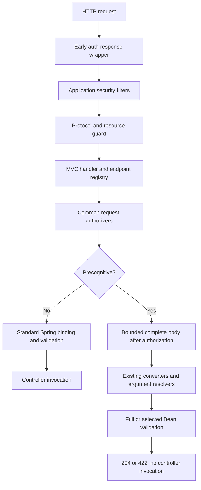

# Architecture

The public API lives in `precognition-core` without Servlet or Boot dependencies. The MVC implementation is shared; the JSON mapper bridge and Boot MVC registration API live in separate auto-configuration modules for each Boot major version. Starters aggregate dependencies and contain no Java classes.

## Why the handler invocation boundary?

Invoking the controller and rolling back a transaction cannot undo side effects such as HTTP calls or published events. Controller AOP alone also does not control when MVC binds and validates the body. This implementation separates normal and precognitive execution at `ServletInvocableHandlerMethod.invokeAndHandle`.

The normal path delegates to Spring's standard implementation. The precognitive path uses the existing argument resolvers and converters. Automatic validators are removed from that request's binder, then the selected validation scope is evaluated once. Shared Validator and resolver instances are not modified.

## Endpoint descriptors and startup verification

After handler mappings are initialized, the verifier inspects each opted-in method's HTTP methods, body, additional parameters, model metadata, security annotations, and MVC customizations. The mapper's deserializable properties are matched with Bean Validation metadata. Client field selections must match this immutable dictionary exactly; they are not interpreted as expressions or unrestricted getter traversal.

If the application already defines a WebMvcRegistrations bean, the starter conditionally backs off, preserving the application's adapter, handler mapping, and exception resolver customizations. If an opted-in endpoint is present and a custom adapter prevents the library adapter from being installed, startup fails. Custom validators or converters cannot silently cause the normal and precognitive paths to evaluate different rules. The platform adapter checks that MVC uses the expected application mapper. Boot's known ValidatorAdapter wrapper is supported without accessing private framework fields.

## JSON and validation

Selected validation uses `validateProperty`, which does not cascade on its own. For nested selections, a precomputed accessor chain locates the owning object and evaluates the leaf property's constraints. Selecting a parent validates the subtree through normal cascading. Overlapping selections are normalized. Client input never becomes a reflection target; it can only select accessors already registered in the schema.

Full validation uses `validate` and normal Bean Validation cascading. A class-level constraint on a SELECTIVE endpoint is a startup error. A FULL endpoint evaluates class-level rules and rejects the selection header. Unknown violation property nodes are reported as configuration errors instead of being silently discarded.

## Security

Servlet filters run in their normal order. The early response wrapper adds protocol recognition headers to relevant 401/403 responses, preserving their status, body, and authentication challenge. Shared authorizers run before JSON binding on both request paths.

The protocol filter and MVC guard use the same header parser. An active signal reaching MVC without protocol context cannot fall through to a normal submission. Duplicate or invalid headers and orphan selections are rejected. Active execution outside REQUEST dispatch, including ERROR dispatch, cannot reach the controller action.

Method security depends on action invocation or AOP, so it is not assumed to run when the action is skipped. Known method-security metadata affecting an opted-in handler is rejected at startup. Use URL security or a shared authorizer for authorization that applies to both request paths.

## Limits and context

The body is parsed once by the converter. After shared authorizers and before argument binding or RequestBodyAdvice begins, the filter wrapper reads at most limit+1 bytes to check the entire raw body. Oversized requests receive 413 before validation. Accepted bodies are passed to the same converter through a bounded byte buffer. Trailing content counts toward the limit even if the converter stops after the first JSON value. The limit also applies when Content-Length is unknown. Normal requests do not use this buffer.

Responses are serialized into a bounded output buffer. Exceeding the response limit produces a stable configuration error instead of a partial validation error list.

Request context is stored in a request attribute and removed at the end of the request. Locale comes from Spring's existing request locale resolution; no global provider state is changed. Observations use only bounded scope and status tags. Without an application registry, observation is a no-op.

## Consequences of the design

This architecture exposes backend validation to form interactions. It does not predict operation results, reserve database state, provide idempotency, or guarantee that the whole application is side-effect-free. Final submissions must still be fully validated and authorized. The Laravel HTTP interaction is tested; the Laravel and Spring execution lifecycles are not claimed to be identical.
